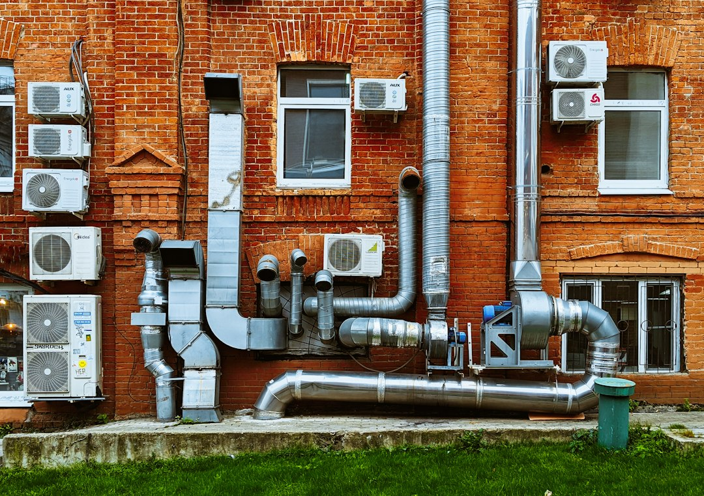

*This post contains affiliate links. As an Amazon Associate, I earn from qualifying purchases at no extra cost to you.*

## Why Attic Ventilation Is Your HVAC System's Silent Partner

Your attic isn't just wasted space - it's a critical zone that directly impacts how hard your HVAC system has to work. When attic ventilation fails, your furnace and air conditioner end up fighting an uphill battle against excessive heat, moisture, and pressure imbalances that no thermostat setting can fully overcome.

Proper attic ventilation keeps temperatures moderate and humidity controlled, which means your HVAC system uses less energy to condition your living spaces. Poor attic ventilation, conversely, can increase your cooling costs by 10–20% and shorten equipment lifespan by forcing compressors and motors to run longer cycles. The problem compounds in older homes and those with inadequate insulation, where attic temperatures can soar 30–50 degrees above outdoor conditions.

This guide walks you through how ventilation affects efficiency, what to look for in your attic, and the practical steps to fix ventilation problems without overhauling your entire system.

Photo by <a href="https://unsplash.com/@vakerbv?utm_source=artlines_blog&utm_medium=referral">Vadim Babenko</a> on <a href="https://unsplash.com/?utm_source=artlines_blog&utm_medium=referral">Unsplash</a>

## Understanding How Poor Ventilation Affects Your Efficiency

### How Poor Attic Ventilation Overworks Your HVAC System

An unventilated or under-ventilated attic becomes a heat trap. In summer, unshaded roof surfaces can reach 150–160°F, and without air movement, that heat radiates downward through the ceiling and into your living space. Your air conditioner then has to push cold air through ducts that run through that superheated attic, warming the air before it reaches your rooms. That means:

- Your AC runs longer to reach your setpoint temperature
- Ductwork loses more conditioned air to the unconditioned attic space
- Compressor cycles increase, generating more wear and higher electricity use
- Return air temperatures rise, making your system less efficient per cycle

In winter, poor ventilation traps warm air from your living space and furnace in the attic. That warmth melts snow on the roof, creating ice dams that can back up under shingles and cause leaks. The furnace must also work against moisture-laden air that reduces its ability to transfer heat effectively.

Beyond temperature, poor ventilation allows moisture to accumulate. High humidity in attics creates mold risk, degrades insulation performance (wet insulation loses 50% of its R-value), and increases pressure inside the attic. That pressure imbalance forces warm or cool air to leak into living spaces, further stressing your HVAC system.

### Temperature and Humidity: Understanding the Efficiency Impact

Attic temperature directly influences the load your HVAC system must bear. When your attic is 130°F and your living space target is 72°F, your AC is fighting a 58-degree temperature differential across the ceiling. Proper ventilation can reduce attic temperatures by 20–30°F in summer by exhausting hot air and pulling cooler outside air across the roof deck.

Humidity is equally important. An attic with 70% relative humidity means moisture is condensing on cooler surfaces like ducts, insulation, and framing. Condensation on ductwork reduces insulation effectiveness and can promote microbial growth. More critically, when humidity is high, any temperature fluctuation - such as nighttime cooling or early morning temperature drops - can cause condensation that damages insulation and wood framing. The [EPA provides guidance on attic moisture control](https://www.epa.gov/mold) to prevent these issues.

The efficiency relationship works both ways. Lower attic temperatures mean shorter cooling cycles and lower compressor load. Lower attic humidity means your insulation performs closer to its rated R-value, reducing the heat gain your AC must overcome. Together, these factors can improve your system's seasonal efficiency by 5–15%, depending on your climate and current ventilation status.

Measuring attic conditions gives you a baseline. A [Govee Indoor Hygrometer Thermometer H5075 with Bluetooth App Control](https://www.amazon.com/dp/B07Y36FWTT?tag=hvacowners-20) lets you monitor temperature and humidity through its app, making it easier to track whether ventilation improvements are working.

## Assessing Your Current Attic Ventilation

Most building codes, including the [International Residential Code (IRC)](https://www.iccsafe.org/), require 1 square foot of ventilation opening (inlet and outlet combined) for every 150 square feet of attic space, or 1:300 if a balanced ridge vent and soffit vent system is installed. You can calculate your attic's square footage and compare it against your existing vent area to estimate your ventilation ratio.

Begin by entering your attic during daylight and looking for signs of poor ventilation:

- **Moisture or staining** on roof framing or sheathing indicates condensation buildup
- **Mold or dark discoloration** on wood or insulation signals excess humidity
- **Insulation clumps or sags** suggest moisture absorption
- **Visible dust and debris** in soffit vents means inlet vents are obstructed
- **No visible daylight** around soffit perimeter or ridge indicates blocked or missing intakes
- **Attic temperature extremes** above 120°F in summer or excessive ice dam formation in winter

Check soffit vents for blockages. Many homeowners install soffit vents but then cover them with insulation or debris, strangling the intake air supply. Outlet vents (gable vents, ridge vents, or turbine vents) should be clear and unobstructed. Ridge vents perform better than gable vents in most climates because they pull air from the entire attic length, but both can work if properly installed.

Use an infrared thermometer to spot-check attic temperature. If it's 25–30°F warmer than outside on a calm day, ventilation is likely inadequate. On humid days, use a hygrometer to measure relative humidity. Anything above 60% in an insulated attic suggests moisture accumulation.

## Improving Attic Ventilation for Better HVAC Efficiency

Start by clearing existing vents. If your soffit vents are blocked, remove insulation, debris, and any mesh or coverings that restrict airflow. Install baffles (venting chutes) above each soffit vent opening to ensure air can flow freely from the soffit up and across the roof without being blocked by insulation.

Add intake ventilation if vents are undersized or missing. Soffit vents are the preferred intake because they draw cooler, outside air. Gable vents can supplement soffit intake, but they work less efficiently in certain wind conditions. If your roof doesn't have adequate soffit overhang, roof vents (also called roof cap vents) can serve as supplemental intakes, though they're less ideal than soffit vents.

Ensure outlet ventilation is adequate. Ridge vents are the most effective outlet because they exhaust hot air from the peak where it naturally rises. Gable vents work but perform unevenly depending on prevailing wind direction. Turbine or spinner vents can boost exhaust capacity but require occasional maintenance as bearings wear. For problematic cases, a powered exhaust fan like the [Broan-NuTone 353 Gable Mount Attic and Garage Ventilation Fan, 760 CFM](https://www.amazon.com/dp/B001E6JC1C?tag=hvacowners-20) can pull air during peak heat or humidity. Use thermostatic or humidistat controls so the fan runs only when needed, not continuously.

Seal air leaks in the attic floor. Gaps around ceiling penetrations (pipes, electrical, return ducts) allow warm air from your living space to leak upward. Seal these with caulk or foam. Proper air sealing reduces the attic pressure imbalance and prevents conditioned air from being wasted.

Upgrade ductwork insulation if ducts run through your attic. Wrap exposed ducts with fiberglass duct wrap (R-8 minimum) or replace undersized ducts with properly insulated flex ducts. This reduces cooling loss in summer and heating loss in winter.

Finally, consider upgrading your thermostat to one that can respond to temperature sensors. The [ecobee Smart Thermostat Premium - WiFi, Siri & Alexa Built-In](https://www.amazon.com/dp/B09XXS48P8?tag=hvacowners-20) comes with a smart sensor that you can place in key zones, which can help your system better balance heating and cooling.

## Common Attic Ventilation Mistakes Homeowners Make

One of the most frequent errors is sealing soffit vents to prevent insulation from flowing into them. Homeowners often see daylight coming through soffit vents and assume it's a gap that needs closing. In reality, that daylight is proof the vent is working. Blocking it starves the attic of fresh air and defeats the entire ventilation system. If insulation is falling through, install baffles instead of sealing the vent.

Another mistake is mixing exhaust outlets in a way that creates back-pressure. Placing a gable vent and a ridge vent on the same attic can cause them to fight each other, especially in certain wind conditions. The rule is: choose one primary outlet type per attic. If you need more capacity, add a second outlet of the same type or install intake vents.

Many homeowners also underestimate the importance of intake ventilation. An attic with plenty of gable or ridge outlet vents but no balanced intake vents will pull air from your living space instead of from outside, creating negative pressure. This draws conditioned air up into the attic and sucks in unconditioned air through other cracks and leaks. Always ensure intake area (soffit, roof, or foundation vents) roughly equals outlet area.

Installing too many unpowered outlet vents without adequate intake is another common problem. Turbine vents, ridge vents, and gable vents all rely on pressure differences and wind to work. Without balanced intake, they can't exhaust effectively, and you've wasted money on installation.

Failing to insulate ducts that run through the attic is also costly. Many homeowners add ventilation but overlook undersized or uninsulated ductwork. If your ducts pass through a 120°F attic without R-8 insulation, 20–30% of your AC output is lost to heat gain before it reaches your rooms. Duct insulation often pays for itself within a few cooling seasons.

Finally, neglecting to maintain vents is a silent problem. Over time, soffit vents clog with paint, dust, and debris. Turbine vents wear out and stop spinning. Powered fans develop weak motors. Check and clean vents annually, especially before cooling and heating seasons.

## How to Evaluate and Improve Your Attic Ventilation: A Step-by-Step Approach

Following these steps will help you diagnose and fix ventilation problems systematically:

1. **Measure your attic space.** Calculate the square footage of your attic (length × width). Divide by 150 to find the minimum total ventilation opening (intake + outlet) required in square feet. For example, a 1,500 sq ft attic needs 10 sq ft of total ventilation.

2. **Inspect soffit vents.** Climb into the attic during daylight and look toward the soffit perimeter. You should see daylight coming through gaps. If the entire soffit is dark, vents are blocked. Use a ladder to inspect from outside, looking for debris, paint, or insulation covering vents.

3. **Clear soffit blockages.** Gently remove insulation away from the soffit interior. Install baffles (1-inch rigid foam or cardboard chutes) above the insulation in line with each soffit vent opening. Baffles direct outside air upward without allowing insulation to fall through.

4. **Verify outlet vents.** Count ridge vent sections, gable vents, or turbine vents. Calculate their combined opening area (manufacturer specs are usually on packaging or online). Compare to your minimum ventilation requirement. If outlet area is less than 50% of intake area, you're undersized.

5. **Monitor temperature and humidity.** Place a hygrometer and thermometer in the attic for 2–3 days. Record peak temperature and humidity. If temperature exceeds 120°F or humidity exceeds 60%, ventilation is inadequate.

6. **Identify and seal air leaks in the ceiling.** Caulk around electrical boxes, pipe penetrations, return duct connections, and exhaust vents using acoustic caulk or foam sealant. This prevents air leakage from living space into the attic.

7. **Insulate exposed ducts.** Wrap any bare ducts with R-8 fiberglass wrap, or replace flex ducts with insulated equivalents. Tape seams with foil mastic tape.

8. **Install baffles and additional intake vents if needed.** If your soffit vent area is less than 50% of your outlet area, consider adding roof vents on the upper roof slopes to boost intake.

9. **Retest after improvements.** Wait 5–7 days for attic conditions to stabilize, then recheck temperature and humidity. Well-ventilated attics typically run 10–20°F cooler than outside air on sunny days.

10. **Schedule annual maintenance.** Every spring and fall, visually inspect soffit vents for blockage, check that turbine vents spin freely, and confirm that powered fans operate if thermostats dictate.

## FAQ: Attic Ventilation and HVAC Efficiency

**Q: Can I seal my attic completely for better insulation?**
No. Completely sealing an attic creates moisture and heat buildup that destroys insulation value, rots framing, and forces your HVAC system to work harder. Building codes require ventilation for a reason. If your goal is better insulation, improve attic insulation R-value and air-seal gaps in the ceiling floor (not the attic roof), which keeps conditioned air in your living space.

**Q: Will adding a powered attic fan reduce my cooling costs?**
A powered fan can help during peak afternoon heat, but it's not a replacement for passive ventilation. Fans use electricity and should run on humidistats or thermostats, not continuously. A fan is most useful if your passive ventilation is severely undersized. For most homes, correcting intake and outlet balance is more cost-effective than adding a fan.

**Q: How often should I clean my soffit vents?**
Inspect soffit vents twice yearly (spring and fall) during HVAC maintenance. Clean them if you see debris, dirt, or paint buildup. In dusty or wooded areas, quarterly checks may be necessary. Clogged soffit vents are one of the leading causes of attic ventilation failure and are easy to overlook.

**Q: Is it okay to have only a gable vent for ventilation?**
A single gable vent provides poor air circulation across the entire attic width, especially in calm-wind conditions. It's better than no ventilation, but it doesn't meet code for most attics. Pair gable vents with soffit intakes and ridge or additional outlet vents for balanced, effective ventilation.

**Q: What's the ideal attic humidity level?**
Attic humidity should stay below 60% year-round. In winter, it should ideally stay below 50% to prevent condensation on cold roof decking. If your attic consistently reads above 60%, ventilation is inadequate, air-sealing is incomplete, or you have moisture sources (bathroom exhaust vents or dryer vents dumping into the attic). Address the root cause before it damages insulation and framing.

## Conclusion

Attic ventilation is an invisible but critical component of HVAC efficiency. By keeping your attic cool and dry, you reduce the load on your air conditioner, lower cooling costs, and extend equipment life. Many homeowners don't realize their HVAC problems originate in the attic - poor ventilation, moisture accumulation, and undersized ductwork all force compressors and furnaces to run longer than necessary.

Start with a thorough inspection: check vent conditions, measure temperature and humidity, and calculate whether your current ventilation meets code. Then clear blockages, install baffles, seal ceiling leaks, and insulate ducts. These steps cost far less than replacing a premature AC compressor or battling ice dams and mold. Within weeks, you'll notice shorter cooling cycles and steadier temperatures throughout your home.

**Keep this guide handy during your seasonal HVAC maintenance. Check your attic vents twice yearly and monitor conditions with a hygrometer - small attention now prevents expensive problems later.**

### Related Reading

For deeper insights into your entire HVAC system, explore [How Home Insulation Affects Your Hvac Efficiency And Energy Bills](/2026/10/20/how-home-insulation-affects-your-hvac-efficiency-and-energy-bills/) and [How To Check And Improve Airflow To Every Room In Your House](/2026/08/20/how-to-check-and-improve-airflow-to-every-room-in-your-house/).

  
<strong>About the Author</strong>

  
The HVAC Owners Manual team researches heating and cooling systems to help homeowners understand what's normal, what's not, and when to call a pro. Our guides are built from manufacturer documentation, industry standards, and contractor-community knowledge.

---
*Bookmark this guide for the next time you work through attic ventilation and hvac efficiency how improper ventilation affects your system, and use the related resources below to keep improving your setup.*
