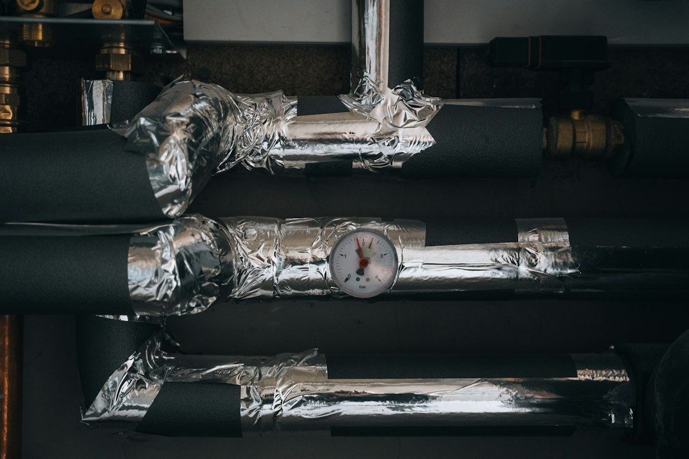

*This post contains affiliate links. As an Amazon Associate, I earn from qualifying purchases at no extra cost to you.*

Every heating season, homes with gas furnaces face a silent risk: carbon monoxide leaking into living spaces. Unlike a noisy furnace malfunction or a visible leak, carbon monoxide is odorless, colorless, and deadly in even small concentrations. Yet homeowners can take concrete steps right now to detect it, prevent it, and respond quickly if it occurs.

The fundamental problem is straightforward. When fuel burns incompletely in a furnace, it produces carbon monoxide as a byproduct. If your furnace's venting system fails, cracks, or becomes blocked, that CO seeps into your home instead of venting safely to the outside. Your family breathes it in without warning.

This guide walks you through what carbon monoxide is, why furnaces produce it, how to protect yourself with detectors, and the maintenance steps that reduce risk. Most critically, you'll learn when to call a professional immediately and how to respond if an alarm sounds.

Photo by <a href="https://unsplash.com/@fabiankleiser?utm_source=artlines_blog&utm_medium=referral">Fabian Kleiser</a> on <a href="https://unsplash.com/?utm_source=artlines_blog&utm_medium=referral">Unsplash</a>

## What Is Carbon Monoxide and Why Furnaces Produce It

Carbon monoxide (CO) is a toxic gas created whenever fuel burns. Natural gas, oil, propane, wood, and coal all produce CO during combustion. Under ideal conditions, a furnace burns fuel completely, creating carbon dioxide and water vapor, which are then vented safely to the outside. But when combustion is incomplete or the venting system fails, CO accumulates instead.

Incomplete combustion happens for several reasons. A cracked heat exchanger is the most dangerous scenario: the metal chamber that transfers heat from the flame to your air supply can develop hairline fractures over years of heating cycles. When a crack forms, flue gases containing CO leak directly into the air stream your system circulates through your home.

Blocked vents are another common culprit. Snow or ice can accumulate on roof vents in winter. Debris, bird nests, or lint buildup can also restrict airflow. A furnace trying to vent against pressure will backdraft, pushing CO-laden gases back into the home. Additionally, negative pressure in the home (from exhaust fans, dryers, or kitchen hoods running without adequate outside air replacement) can pull CO-laden gases down and into living spaces.

Corrosion and age accelerate the problem. After 15-20 years, furnace components deteriorate. Welds weaken. Metal develops thin spots. A furnace that functioned safely at year five becomes a CO risk by year twenty. This is why manufacturer guidance recommends annual professional inspections on any furnace over 10 years old.

Homeowners often overlook a third factor: improper furnace installation or repair. If a technician connects venting incorrectly, installs the wrong diameter ductwork, or fails to slope venting properly, CO will not exit as designed. Gravity and pressure imbalances force it back toward the home.

## Health Risks of Carbon Monoxide Exposure

Carbon monoxide binds to hemoglobin in your blood with an affinity roughly 200 times stronger than oxygen. When CO fills your blood, your body's cells suffocate even though you're breathing normally. The damage is dose-dependent: higher concentrations over longer periods cause worse harm.

Mild exposures produce flu-like symptoms. Headache, dizziness, weakness, nausea, and confusion appear after minutes to hours, depending on CO concentration and individual sensitivity. Many homeowners mistake these signs for the flu and open windows or rest, not realizing they've been poisoned. The symptoms fade once you leave the contaminated space, reinforcing the confusion.

Moderate exposures cause rapid, severe symptoms. Disorientation, loss of consciousness, and cardiac stress occur within 30 minutes to a few hours at sustained levels of 100-200 parts per million (ppm). At 400 ppm, unconsciousness comes within three hours.

Severe exposures (above 800 ppm) cause death in under an hour. At 1,600 ppm or higher, death occurs in minutes. The tragedy is that victims often don't recognize the danger; they simply become confused and lose the ability to escape.

Children, elderly persons, people with anemia, heart disease, or respiratory conditions, and pregnant women face higher risk from the same CO exposure as healthy adults. Their bodies have reduced oxygen reserves or diminished ability to compensate as hemoglobin becomes saturated with CO.

Long-term low-level exposure (10-35 ppm over weeks or months) can cause subtle neurological damage, memory problems, and cardiovascular stress. According to the [EPA's carbon monoxide safety guidance](https://www.epa.gov/indoor-air-quality-iaq/carbon-monoxide-co-poisoning-prevention), chronic low-level CO exposure increases heart attack and stroke risk, though scientists continue studying the mechanisms.

**CRITICAL SAFETY WARNING:** Carbon monoxide kills without warning. If your CO detector sounds an alarm, evacuate immediately. Get everyone outside to fresh air. Do not re-enter the home to investigate, turn off the furnace, or gather belongings. Call 911 or your local fire department from outside. Only trained professionals should enter to locate and repair the source. Breathing CO while searching for the problem can render you unconscious. Do not rely on feeling sick to tell you when danger is present; CO poisoning can occur before symptoms appear.

## Carbon Monoxide Detectors: Types, Placement, and Selection

A carbon monoxide detector is your family's first warning system. When levels reach 35 ppm for 8 hours, or 200 ppm within minutes, the alarm sounds. Detectors must meet safety standards set by the [Consumer Product Safety Commission (CPSC)](https://www.cpsc.gov/). Detectors fall into two categories: electrochemical sensors and biomimetic sensors. Both work reliably; electrochemical detectors respond slightly faster but both meet safety standards.

**Plug-in detectors** plug directly into a wall outlet and include battery backup. Models like the [Kidde Carbon Monoxide Detector, Plug-in Carbon Monoxide Detector with AA Battery Backup, 85 dB Alarm, LED Status Light Indicators, 3rd Edition](https://www.amazon.com/dp/B0DT1MYBNV?tag=hvacowners-20) offer plug-in protection with an 85 dB alarm and LED status light indicators.

**Hardwired detectors** integrate with your home's electrical system and include battery backup for power outages. These provide permanent protection without outlet placement constraints. Installation requires running wiring, usually by a licensed electrician.

**Battery-powered standalone detectors** offer flexibility for apartments or homes where hardwiring isn't feasible. The [First Alert SC5 Battery Smart Smoke & Carbon Monoxide Alarm](https://www.amazon.com/dp/B0DS2W3794?tag=hvacowners-20) combines smoke and CO detection, reducing the number of devices while providing dual protection.

Placement matters significantly. The highest risk occurs where CO enters the home: near your furnace, in the basement near the water heater, and near any gas appliance. Mount detectors 4-6 inches from the ceiling in these areas, as CO disperses upward initially. Place at least one detector in each bedroom hallway (or in the bedroom itself in small homes) so alarms wake sleeping residents. Avoid mounting directly above stoves or ovens, where normal cooking fumes trigger false alarms. Keep detectors away from furnace exhaust vents; alarms shouldn't sound from normal furnace operation.

For a typical single-family home, place one detector within 10 feet of the furnace room, one in the main hallway between bedrooms and living spaces, and one additional detector on the highest floor if your home is multi-story. This three-point system catches CO at its source and ensures warning reaches every occupant.

Test detectors monthly by pressing the test button. Replace batteries twice yearly (during daylight saving time changes) or when the low-battery indicator sounds. Replace the entire detector every 5-7 years; sensors degrade over time. Mark your replacement date on the detector itself with a permanent marker.

## Furnace Maintenance to Reduce Carbon Monoxide Risk

The best CO defense is preventing leaks in the first place. Annual furnace inspections catch problems before they become dangerous. A professional technician inspects the heat exchanger for cracks (often using a borescope camera to peer inside), checks all venting connections, clears any blockages, examines the draft diverter, and tests combustion efficiency.

You can perform one critical maintenance task yourself: air filter replacement. A clogged filter restricts airflow, increases furnace strain, and can trigger improper combustion. [Filtrete 16x25x1 Air Filter, MERV 11, MPR 1000, 4 HVAC Filters | Allergens & Pet Dander, 3-Month AC/Furnace Filters, Cleaner Air, Reliable Airflow, (Act. Size 15.68x24.68x0.81 in)](https://www.amazon.com/dp/B005GZ89WU?tag=hvacowners-20) is a 3-month furnace filter designed for allergens and pet dander. Replace your furnace filter every 1-3 months, depending on household dust levels, pet hair, and the filter's MERV rating.

Check your furnace venting after winter storms. Walk around your home's exterior and verify that all vent terminations are clear of snow, ice, leaves, and debris. If vents appear blocked, clear them carefully or call a technician. Never allow downspouts, trash cans, or other structures to cover vents.

Ensure negative pressure doesn't accumulate in your home. If you use a kitchen range hood, bathroom exhaust fan, or clothes dryer, verify that outside air can enter elsewhere. Open a window slightly during extended furnace operation, or consult an HVAC contractor about installing fresh air dampers or intake vents.

Schedule professional service every 1-2 years for furnaces over 10 years old, or annually if your furnace is 15+ years old. Request that the technician check venting integrity, inspect the heat exchanger, measure combustion efficiency, and test CO levels at the furnace outlet (should be zero or near zero; if levels are elevated, the furnace requires repair or replacement).

### Recognizing the Signs of Furnace Failure

Certain furnace behaviors signal that CO risk may be elevated. If your furnace produces more soot than usual, or you notice black soot accumulating around the furnace, venting pipes, or near wall registers, combustion is incomplete. This is a red flag for CO production.

Corrosion or water stains on furnace components or venting pipes indicate moisture condensation, a sign that flue gases are cooling before exiting, often because venting is blocked or undersized.

Unusual furnace noises, such as banging, whistling, or grinding, can signal cracks in the heat exchanger or pressure imbalances that affect venting.

If your CO detector sounds during normal furnace operation (not just after a battery change or test), take it seriously immediately. Don't assume it's a false alarm.

Doors or windows in your furnace room or basement that feel heavy to open, or flames on gas stove burners that lean inward, indicate negative pressure that can backdraft CO into living spaces.

Any of these signs warrant a professional inspection. Do not ignore them in hopes they'll resolve on their own.

## How to Respond If Your Carbon Monoxide Detector Alarms

1. Evacuate immediately. Do not attempt to locate the source, investigate the furnace, or gather valuables. Leave the home and go outside to fresh air.

2. Call 911 from outside. Tell the dispatcher you have a CO alarm. Fire departments have CO detection equipment and can assess the home safely.

3. Do not re-enter. Stay outside until emergency responders clear the home. Breathing CO while indoors delays escape and can cause unconsciousness.

4. After responders assess, if CO is detected and the source is identified as your furnace, the technician will advise repair or replacement. Do not use the furnace again until a qualified technician has repaired the problem.

5. Document the incident. Keep records of the date, time, and CO level detected. If your home has a code enforcement or health department log, report the incident.

Common false alarms occur from detector malfunction, battery issues, or sensor end-of-life. If you've evacuated, called 911, and responders find no CO, replace the detector battery. If alarms repeat, replace the detector itself. Press the test button during calm hours to distinguish between false alarms (where the detector tests normally but sounds during standby) and real threats.

## Common Mistakes and Safety Problems Homeowners Make

**Mistake 1: Ignoring mild symptoms.** Many homeowners experience headaches, nausea, or dizziness and assume it's a cold or stress. If symptoms appear when the furnace runs and fade when you leave home, suspect CO. Don't wait for a detector to confirm; evacuate, call 911, and let professionals assess.

**Mistake 2: Placing detectors in wrong locations.** Mounting a detector directly next to a furnace exhaust vent causes false alarms from normal furnace operation, breeding complacency. Mounting them too high or too low reduces sensitivity. Mount them 4-6 inches below the ceiling, 10 feet away from fuel-burning appliances, and in sleeping areas so alarms wake residents at night when furnace runs and occupants can't open windows.

**Mistake 3: Neglecting annual furnace inspections.** Many homeowners run furnaces 10+ years without professional inspection. During that time, heat exchangers crack silently. Minor issues compound. By the time a problem is detected, years of potential CO leakage may have occurred. Annual inspections catch problems while they're small.

**Mistake 4: Assuming furnace makes no CO under normal conditions.** Some homeowners believe "if my detector hasn't alarmed, I'm safe." Detectors only alarm when CO reaches dangerous levels. Low-level CO (20-30 ppm) can accumulate for weeks without triggering the alarm, but still cause neurological damage. Only professional inspections and combustion efficiency tests catch these situations.

**Mistake 5: Blocking furnace vents in winter.** Some homeowners wrap furnace vents with plastic or duct tape to reduce heating loss. This blocks venting completely, forcing CO back into the home. Never block, wrap, or cover furnace vents. If vents are in windy areas, install professionally designed vent hoods that prevent wind-driven rain and snow infiltration while maintaining airflow.

**Mistake 6: DIY furnace repair.** Homeowners sometimes attempt to patch cracked heat exchangers or re-seal venting connections with caulk or tape. These repairs fail quickly. If a heat exchanger cracks or venting is compromised, only licensed HVAC technicians should repair it. If repair costs are prohibitive, furnace replacement is safer than living with a CO risk.

**Mistake 7: Using a generator indoors.** During power outages, some homeowners run portable generators inside the home, garage, basement, or near open windows. Generators produce massive quantities of CO. Even brief exposure can cause death. Generators must run outdoors, at least 20 feet away from windows, doors, and vents. This is non-negotiable.

## Frequently Asked Questions

**Q: Can my furnace produce carbon monoxide if it's newer?**

A: Yes. Any furnace powered by natural gas, propane, or oil produces CO during combustion. Newer furnaces have better efficiency and lower risk of heat exchanger cracks, but they are not immune. A manufacturing defect, improper installation, or a venting blockage can cause CO leakage in a new furnace. The risk declines with age up to 15 years, then increases. This is why annual inspections matter regardless of furnace age.

**Q: Should I install a CO detector if I have an electric furnace or heat pump?**

A: No CO detector is needed for electric heating systems, which produce no combustion gases. However, if your home has any gas appliances (stove, water heater, fireplace, dryer), install CO detectors. Also, if your home has an attached garage, CO from vehicle exhaust can infiltrate the home, so detectors are recommended even with all-electric heating.

**Q: How often should I replace my furnace to avoid CO risk?**

A: Furnaces typically last 15-20 years. Replacement is wise around year 15-18 if the furnace has not been serviced regularly, if the home has a history of furnace problems, or if the efficiency rating is very poor. Replacement is critical if a heat exchanger cracks or the furnace produces elevated CO. If your furnace is under 15 years old and has been serviced annually, replacement is not urgent for CO prevention alone, though costs and efficiency may favor upgrades.

**Q: Can I clean my own furnace to reduce CO risk?**

A: You can clean or replace the air filter and clear external vents, but internal furnace cleaning should be done by professionals. The heat exchanger, combustion chamber, and burners require specialized tools and expertise. Improper cleaning can cause damage or introduce contaminants that worsen combustion problems. Annual professional service includes necessary cleaning.

Carbon monoxide is a real but preventable threat. The combination of CO detectors, annual furnace inspections, basic maintenance, and prompt action when alarms sound protects your family. A single detector costs $30-50 and lasts 5-7 years. Professional furnace inspection costs $100-200 annually. These costs are trivial compared to the risk of CO poisoning, which can disable or kill your family in minutes.

Start today by placing CO detectors in your home if you don't have them. Test them monthly. Mark your calendar for an annual furnace inspection in the fall, before the heating season begins. Clean or replace furnace filters every 1-3 months. Check that all furnace vents are clear. These steps form a simple, affordable, and highly effective defense.

**Subscribe to stay updated on furnace maintenance and safety tips each heating season.**

Learn more about comprehensive furnace care in our guide [How To Extend The Life Of Your Hvac System](/2026/06/12/how-to-extend-the-life-of-your-hvac-system/), which covers seasonal maintenance and inspection schedules. For fall-specific preparation, read [Prepare Hvac For Fall](/2026/07/30/prepare-hvac-for-fall/).

---

  
<strong>About the Author</strong>

  
The HVAC Owners Manual team researches heating and cooling systems to help homeowners understand what's normal, what's not, and when to call a pro. Our guides are built from manufacturer documentation, industry standards, and contractor-community knowledge.

