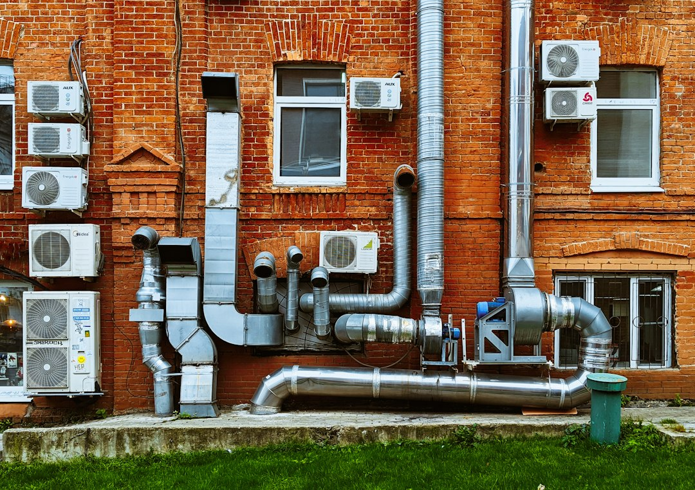

Hiring an HVAC contractor well requires more front-end effort than most homeowners expect, but the stakes justify every step. A system installed without a load calculation may underperform for its entire service life. A permit-free installation creates complications that surface years later at refinancing or resale. Get it right upfront and you'll have a system that delivers reliable comfort and rated efficiency for fifteen to twenty years. Rush the process and you may spend that same period managing inadequate heating and cooling, voided equipment warranties, and expensive rework.

This guide walks through every stage of the hiring process: the credentials worth verifying, the questions worth asking, the red flags that warrant walking away, and the standard of documentation you should expect before signing anything.

Photo by <a href="https://unsplash.com/@vakerbv">Vadim Babenko</a> on <a href="https://unsplash.com/photos/a-building-with-a-bunch-of-pipes-on-the-side-of-it-IUuVB1nLsQU">Unsplash</a>.

## Why Contractor Quality Determines System Performance

Equipment selection and installation both influence system performance. Ask how the contractor will evaluate your home, existing ducts, and airflow instead of relying on the size of the old unit. ENERGY STAR recommends a home evaluation and written, itemized proposals in its [contractor hiring guidance](https://www.energystar.gov/saveathome/heating-cooling/10-tips-hiring).

An oversized air conditioner may cycle frequently and provide poor humidity control. An undersized unit may struggle during demanding conditions. Duct restrictions, envelope problems, controls, maintenance, and equipment faults can cause similar symptoms. A capable contractor investigates those possibilities before attributing every comfort complaint to equipment capacity or recommending a replacement.

Confirm permit and inspection requirements with your local building department. Where required, an inspection provides a code-compliance checkpoint; it does not guarantee comfort, energy savings, or workmanship. Put responsibility for obtaining permits, arranging inspections, and addressing deficiencies in the agreement. Ask the department what records you should retain when the project closes.

## How to Find and Vet HVAC Contractors

Before you request a single estimate, understand the credential landscape so you can evaluate what contractors present rather than simply accepting what they tell you.

### Qualifications That Distinguish Capable Contractors

**Applicable contractor license:** Check state and local requirements for your location and scope. Verify the contractor’s legal identity, license status where required, and any available disciplinary information with the responsible authority. Make sure the entity submitting the proposal is the one you verified. A number on a business card is not sufficient evidence by itself.

**EPA Section 608 Certification:** For U.S. refrigerant work, verify the appropriate technician credential. The [EPA explains the covered activities and certification types](https://www.epa.gov/section608/section-608-technician-certification-requirements), including work that could release refrigerant. Closely supervised apprentices have an exemption, and the credential does not expire. Section 608 is not a substitute for applicable contractor licensing or proof of skill in unrelated HVAC tasks.

**Technician training:** Ask who will perform the work and what training is relevant to the proposed equipment. Voluntary credentials can support that discussion, but a credential alone does not establish installation quality. Request comparable references and a description of the commissioning checks the crew will document.

**Design process:** Ask how the contractor documents load calculations, equipment selection, and duct requirements. Trade association membership alone is not proof that a particular design method was used. Request the project-specific calculations and the assumptions behind them rather than treating a logo on the proposal as a substitute.

**Business History and References:** Years in business is not a guarantee of quality, but a contractor who has operated for more than five years under the same name and legal entity has a track record that can be investigated. Ask for references from projects comparable to yours - full system replacements if that is what you are having done - and follow up with those references by phone rather than relying on curated written testimonials.

### Initial Verification Steps

Follow the first steps of the hiring process to verify credentials and get your initial bids:

1. **Verify credentials before scheduling:** Check the contractor’s legal business name and applicable license with your state or local authority. Request insurance evidence and verify it through the insurer or agent. Ask about employees, subcontractors, and workers’ compensation requirements in your jurisdiction. Insurance limits and coverage needs vary; consult your own insurer if you are unsure. Confirm the relevant refrigerant-work credentials with the company before the visit.

2. **Request three written bids minimum:** Budget two to three weeks for the full bidding process on a non-emergency replacement. Compare bids on total value, not headline price. Each proposal should include equipment model numbers, efficiency ratings, warranty terms, and explicit language about permitting responsibility and cost. A bid that lists only "air conditioner" without a model number or SEER2 rating is not a comparable proposal - it is a placeholder that can be filled with any equipment at any quality level after you have signed the contract.

## Getting the Right Estimate

After you have verified credentials and received multiple bids, the next steps focus on evaluating those bids and getting clear documentation before committing:

3. **Demand a Manual J load calculation:** Ask during your initial phone screening whether their process includes a load calculation. If the answer is no, ask them to incorporate one into the estimate or move on to contractors who treat it as standard practice. Manual J is the industry-standard methodology for calculating the heating and cooling loads of a specific building. It accounts for square footage, insulation levels, window area and orientation, local climate data, and occupancy patterns. Without it, equipment sizing is a guess. Some companies include Manual J at no additional charge; others charge a modest fee separately. Either approach is acceptable. Skipping it entirely is not.

4. **Review insurance coverage carefully:** Ask the insurer or agent to confirm the policy period, business identity, and relevant coverage. Discuss any requested additional-insured endorsement with your own insurer; a certificate alone does not change the policy or guarantee a claim will be paid. Clarify whether subcontractors carry their own coverage. Keep the written evidence with your project records.

5. **Do not let pressure force early decisions:** Where practical, compare several written proposals before committing, while accounting for any genuine emergency. The purpose is not to find the lowest number but to understand the market rate well enough to identify outliers in both directions and ask informed questions about why bids diverge. High-pressure tactics  -  "this price is only good today," "we have one opening left this week," "I can skip the permit to save you money"  -  are red flags that warrant ending the conversation. Legitimate contractors stand behind quoted prices long enough for you to make a reasoned decision.

### What a Proper Estimate Should Include

A thorough written estimate is a diagnostic document. It reveals whether a contractor understands the scope of work and intends to communicate clearly, or whether they are keeping the proposal vague to preserve flexibility after the contract is signed. A proper estimate should include the following:

- **Equipment specifications:** Manufacturer, model number, SEER2 or AFUE rating, and capacity in BTUs for every piece of primary equipment being installed. Vague descriptions offer no protection.
- **Warranty terms:** Both the manufacturer's parts warranty and the contractor's labor warranty, stated explicitly in years and covering what is and is not included.
- **Permitting:** A clear statement that the contractor will obtain all required permits and include the cost in the project price. If permitting is listed as the homeowner's responsibility, that is unusual and warrants direct clarification.
- **Scope of work:** What is being removed, what is being installed, and what is being left in place. If ductwork modifications are required, they should be itemized rather than bundled into a lump sum.
- **Payment schedule:** How much is due at signing, how much at substantial completion, and what triggers final payment. Check local deposit limits and tie payments to documented milestones; do not pay the full project price upfront.
- **Timeline:** Expected start date and estimated project duration.

Estimates lacking model numbers, permitting language, or warranty terms are incomplete bids. Request revisions before comparing them against thorough proposals from other contractors.

### Understanding Equipment and Installation Costs

When comparing bids, ask why each item is necessary for your home. A thermostat upgrade, filter cabinet, or duct modification should have a defined purpose and a separate price. Diagnostic instruments are not a prerequisite for hiring a contractor, and refrigerant, live electrical, gas, and combustion work belongs with an appropriately qualified professional. Ask the contractor to demonstrate normal controls and safe homeowner maintenance at handover.

Compare the installed price of each option, expected operating costs, and the assumptions behind any savings estimate. Higher efficiency does not guarantee that the additional purchase cost will be recovered. Usage, weather, utility rates, financing, and installation quality affect the result. Verify any incentive directly with its administrator before counting it in your budget; do not assume a particular tax credit or rebate remains available.

When a bid is substantially lower than the others, ask the contractor to explain the difference in writing. Compare included permits, design work, electrical changes, duct repairs, equipment specifications, and warranties. A lower price can reflect a different scope or legitimate business differences; it is a reason to investigate rather than proof of poor workmanship.

### A Bid Comparison Worksheet You Can Actually Use

Copy the same questions into a note for each contractor. Leave an unanswered field marked “not provided” instead of filling it from a sales conversation you cannot later verify. Send the missing questions back together so the contractor can return one revised proposal. Comparing complete proposals is easier than reconstructing several versions from emails and handwritten notes.

| Comparison field | What to record | Question when it is missing |
|---|---|---|
| Business and assigned crew | Legal name, license where applicable, subcontractors | Who is responsible for installation and warranty service? |
| Home evaluation | Calculation method, assumptions, duct findings | What changed since the existing unit was selected? |
| Equipment | Exact indoor and outdoor models and controls | Are these the complete matched-system specifications? |
| Included work | Removal, disposal, ducts, electrical and drain work | Which existing components will remain? |
| Permits and inspection | Responsible party, fees, inspection steps | How will completion be documented? |
| Payment and changes | Deposit, milestones, written change procedure | What approval is required before extra work starts? |
| Commissioning | Tests and results delivered at handover | What records will show the system was checked? |
| Aftercare | Labor coverage, exclusions, registration responsibility | Who do I contact if the first-season performance is poor? |

Do not compare only equipment brands. Two proposals using the same unit can include very different duct work, controls, start-up checks, and service commitments. Conversely, different brands can offer comparable practical outcomes when the scope and design are suitable. Ask each contractor to identify the largest uncertainty in the job and how that uncertainty will be priced or resolved.

### Before You Authorize a Change

Hidden conditions sometimes appear after removal begins. Agree in advance that changes need a written description, price, and effect on the schedule. If a contractor discovers damaged ducts, ask for photographs and an explanation of the proposed remedy. Clarify whether the original scope still works, whether a safer temporary arrangement is available, and whether a second quote is practical before authorizing a major addition. Never ask a crew to continue with a known safety hazard simply to avoid a change order.

Keep the signed proposal, approved changes, payment receipts, model and serial numbers, warranty documents, inspection records, and commissioning report together. Take photographs of accessible equipment labels after installation. A clear record helps a future service technician understand what was installed and helps you distinguish a warranty question from new maintenance work. It also makes follow-up conversations more precise: you can point to an agreed item rather than trying to remember what a salesperson promised.

For broader consumer guidance, the [FTC’s home improvement advice](https://consumer.ftc.gov/articles/how-avoid-home-improvement-scam) explains warning signs, written estimates, and the need to check local payment rules.

## Protecting Yourself: Red Flags and Common Mistakes

### Red Flags in Estimates and Contractor Behavior

Certain patterns in written estimates and in-person contractor interactions are reliable warning signs. Individually, some may have benign explanations. Multiple signals together warrant finding a different contractor entirely.

**In estimates:**
- No equipment model numbers or efficiency ratings specified
- Permitting listed as optional or the homeowner's responsibility without explanation
- No warranty language, or a labor warranty shorter than one year
- Full payment demanded upfront, or deposits that conflict with local rules
- No mention of a load calculation in the scope of work

**In contractor behavior:**
- Pressure to sign before you have had time to review competing proposals
- Resistance to providing written documentation of credentials or scope
- Any suggestion to skip permits to save time or money
- Inability or unwillingness to produce verifiable insurance certificates
- Dismissiveness toward questions about licensing, process, or equipment specifications

If a contractor reacts to reasonable, professional questions about licensing, insurance, or permitting with impatience or evasion, that reaction is itself meaningful information about how disputes will be handled once the job is underway and leverage has shifted.

### Common HVAC Contractor Mistakes to Avoid

The most common error homeowners make is prioritizing the lowest bid without evaluating qualifications. Unclear insurance coverage can complicate a claim if an injury occurs; verify the applicable requirements before hiring. Similarly, accepting an equipment recommendation without a load calculation means accepting an installation that may underperform for a decade or longer.

Additional mistakes include failing to confirm permitting responsibility before signing, not requesting model numbers in writing, and not verifying that the contractor is actively licensed - not just previously licensed. Never accept verbal assurances about permits, scope changes, or warranty terms. Record agreed responsibilities and changes in writing. A change order that is discussed in conversation but never written down is a dispute waiting to surface at the worst possible time.

Do not assume that a contractor recommended by a neighbor has already been vetted for the credentials that matter. People recommend contractors based on outcomes they can observe - final price, apparent professionalism, completed work - not on whether the assigned technician had appropriate refrigerant-work certification or whether a proper load calculation was performed before equipment was selected. Verify credentials independently regardless of the referral source.

## If Problems Arise: Troubleshooting

### What to Do If Something Goes Wrong

Even with thorough vetting, problems arise. Knowing your options in advance allows you to respond decisively rather than reactively.

**If the installation fails inspection:** Obtain the written findings and ask the contractor for a correction plan. Review the agreement and local requirements to determine responsibility for the work and costs. Arrange the required reinspection and keep its result. If the contractor will not respond, ask the licensing authority or local consumer protection office about the available complaint process.

**If the system underperforms after installation:** Record the affected rooms, thermostat settings, outdoor conditions, and symptoms. Request the commissioning documentation and a service visit under the applicable agreement or warranty. An independent assessment may help distinguish sizing, airflow, controls, envelope, and equipment problems. If you smell gas or a carbon monoxide alarm sounds, leave the area and follow emergency-service guidance; do not troubleshoot combustion equipment yourself.

**If you discover missing permits:** Ask the building department what is required to regularize the work. The process, inspection access, and correction costs vary locally. Preserve the original contract and written representations, then seek advice from the relevant consumer protection office or a qualified local adviser if responsibility is disputed.

**If the contractor abandons the job:** Photograph the site, preserve payment records and correspondence, and document the remaining scope. Avoid using incomplete or unsafe equipment. Contact the appropriate licensing or consumer protection authority about your options. If a bond applies to the project, ask its issuer about the claim process and deadlines.

## Frequently Asked Questions

**Should I ask for a Manual J calculation before or after receiving bids?**

The Manual J calculation should happen before the equipment recommendation - meaning it should be part of the bidding process itself rather than a separate step. A contractor who arrives with an equipment recommendation before spending meaningful time evaluating your home has based that recommendation on assumptions, not measurements. Ask during your initial phone screening whether their process includes a load calculation. If the answer is no, ask them to incorporate one into the estimate or move on to contractors who treat it as standard practice. Some companies include Manual J at no additional charge as part of the free estimate; others charge a modest fee separately. What is not acceptable is an equipment recommendation with no load calculation behind it.

**What should I check on a contractor's certificate of insurance?**

Verify the business name, policy period, relevant coverage, and insurer contact details. Ask how employees and subcontractors are covered. Your own insurer can help you assess appropriate limits and whether an additional-insured endorsement makes sense. Do not assume that a certificate itself creates coverage or guarantees payment for a future loss.

**How long should a standard HVAC installation take?**

Ask for a schedule specific to your scope, including equipment delivery, utility coordination, permits, inspection, and commissioning. A simple replacement may take less time than a project involving ducts or electrical changes, but a universal duration is not a reliable quality test. Put milestones and the procedure for communicating delays in writing.

**Is it worth paying more for a higher-efficiency unit?**

Compare the additional installed cost against a realistic estimate of annual operating savings. Ask for the utility rates, usage assumptions, and equipment performance data behind the estimate. Consider comfort and available incentives separately. The right choice depends on your home and budget; higher efficiency alone does not guarantee a favorable payback.

**What happens if my contractor pulls permits but the inspection fails?**

Use the inspection findings and written agreement to establish a correction plan. Confirm who arranges reinspection and how disputed costs are handled under the contract and local rules. Keep the job open administratively until the required inspection process is complete. Seek local advice if the contractor refuses to address the findings.

## Conclusion

Hiring an HVAC contractor requires preparation because the installation affects comfort, operating costs, and future service. A system selected without evaluating the home may be poorly matched to its heating and cooling needs. Missing permits can also complicate later work. Careful hiring cannot guarantee a particular service life, but it gives you a clearer scope, documented responsibilities, and a practical way to compare proposals before committing.

Bookmark this page before your next contractor conversation so the credential checklist and red flags are ready when you need them.

## Related Reading

- [Common HVAC Contractor Scams and How to Avoid Them](/2026/04/30/2026-04-30-common-hvac-contractor-scams-and-how-to-avoid-them/)
- [HVAC Rebates and Tax Credits Homeowners Should Know About](/2026/09/19/hvac-rebates-and-tax-credits-homeowners-should-know-about/)

---

  
<strong>About the Author</strong>

  
The HVAC Owners Manual team researches heating and cooling systems to help homeowners understand what's normal, what's not, and when to call a pro. Our guides are built from manufacturer documentation, industry standards, and contractor-community knowledge.

