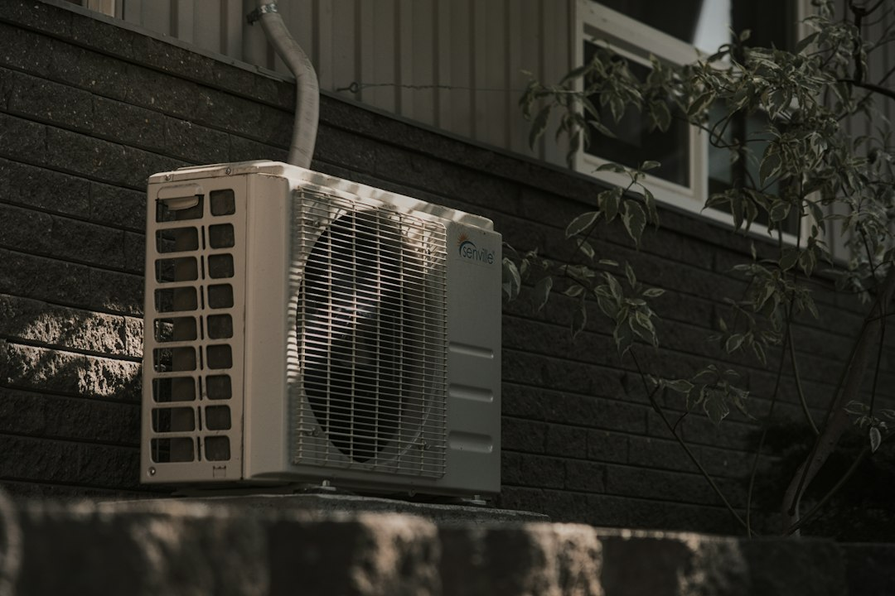

*This post contains affiliate links. As an Amazon Associate, I earn from qualifying purchases at no extra cost to you.*

Most homeowners frame this choice as "new technology versus the old way," and that framing leads to bad decisions. The real question is simpler: does your house already have ductwork worth keeping, and do you need to heat and cool the whole building or only parts of it? If the answer is "good ducts, whole house," a ducted system is usually the safer buy. If the answer is "no ducts, an addition, a garage conversion, or a few rooms that never feel right," a ductless mini split is often the better tool by a wide margin.

Ductless mini splits are not a universal replacement for central HVAC, and ducted systems are not obsolete. Each wins in specific situations, and the expensive mistakes happen when a homeowner picks the wrong one for the house. Mini splits win on zoning, efficiency in homes with leaky or missing ducts, and retrofits. Ducted systems win on whole-home uniformity, hidden equipment, and the lowest upfront cost per square foot in houses with sound duct runs.

This guide covers how the two approaches differ, what they cost, how they behave in cold weather, and a five-step framework to use before you collect quotes.

Photo by <a href="https://unsplash.com/@everettp?utm_source=artlines_blog&utm_medium=referral">Everett Pachmann</a> on <a href="https://unsplash.com/?utm_source=artlines_blog&utm_medium=referral">Unsplash</a>

## Ductless Mini Split Heat Pump Systems: How They Differ From Ducted HVAC

A ductless mini split has two main parts: an outdoor compressor unit and one or more indoor air handlers, joined by a small bundle of refrigerant tubing, a power cable, and a condensate drain. The bundle passes through a roughly three-inch hole in the wall. No ducts are involved. Each indoor head conditions the room it sits in, and many multi-zone setups run several heads from a single outdoor unit.

A traditional ducted system works the opposite way. One central air handler or furnace pushes conditioned air through supply ducts and pulls it back through return ducts. A split-system air conditioner or heat pump handles cooling, and often a gas furnace handles heating. One thermostat controls the whole house.

The efficiency story starts with the ducts. The U.S. Department of Energy notes that [ductless mini-split heat pumps](https://www.energy.gov/energysaver/ductless-mini-split-heat-pumps) avoid the energy losses associated with the ductwork of central forced-air systems, which can account for more than 30 percent of energy consumption for space conditioning, particularly when ducts run through an unconditioned attic. If your ducts are leaky, uninsulated, or routed through a hot attic, a ducted system carries a penalty every hour it runs.

Most modern mini splits use inverter-driven compressors. Instead of switching fully on and off, the compressor ramps its speed up and down to hold a setpoint. That is the same idea behind the variable-speed equipment covered in [Variable Speed Vs Single Stage Hvac What To Know Before Buyi](/2026/06/06/variable-speed-vs-single-stage-hvac-what-to-know-before-buyi/). It produces steadier room temperatures, lower noise, and better part-load efficiency. One caution on shopping: an industrial motor controller like the [Mitsubishi Electric FR-D720-0.2K compact inverter](https://www.amazon.com/dp/B00VMAEN64?tag=hvacowners-20) is a variable frequency drive for ordinary AC motors. It illustrates the same speed-control concept, but it is not a mini split part and should never be wired into HVAC equipment. Inverter boards inside a mini split are matched to that specific compressor by the manufacturer.

In short, a mini split is a heat pump designed around zones and inverter control, while a ducted system is designed around one central source and a distribution network. Cost and comfort differences flow from that.

## Cost, Efficiency, and Cold-Weather Performance Compared

Prices vary heavily by region, installer, and equipment tier, so treat the figures below as directional ranges to sanity-check quotes, not as bids.

| Factor | Ductless mini split | Traditional ducted system |
|---|---|---|
| Typical installed cost | Often higher per ton; single-zone is modest, multi-zone climbs quickly | Often lower per ton if ducts are sound and sized correctly |
| Duct losses | None | Can be significant in leaky or attic ducts |
| Zoning | Built in, room by room | Requires dampers or a zoning upgrade |
| Install disruption | Small wall penetration per head | Minimal if ducts exist, major if they must be built |
| Appearance | Visible indoor heads | Hidden equipment, visible registers only |
| Filtration and humidity control | Basic filters, limited fresh air | Easier to add media filters and whole-home dehumidification |
| Heating source | Heat pump only | Heat pump or gas/electric furnace |

Upfront cost is the first trap. A single-zone mini split serving an addition is frequently cheaper than extending ducts. But a five-head multi-zone system for a whole house can cost noticeably more than replacing a central unit on healthy ducts. Each added head also adds a line set, a wall penetration, and labor. For a deeper breakdown of cooling-only choices, see [Central Ac Vs Mini Split Which Right Home](/2026/06/19/central-ac-vs-mini-split-which-right-home/).

Operating cost is where mini splits often earn it back. With no duct losses and conditioning limited to occupied rooms, the same comfort can use meaningfully less electricity. Check the SEER2 and HSPF2 ratings rather than the older SEER number, and see [Seer Ratings Explained What They Mean For Your Energy Costs](/2026/09/13/seer-ratings-explained-what-they-mean-for-your-energy-costs/) for how those translate to dollars.

Cold weather is the question every northern buyer asks. Older heat pumps lost much of their capacity as temperatures dropped. Cold-climate models from major manufacturers are rated to deliver substantial heating output at very low outdoor temperatures, and the Northeast Energy Efficiency Partnerships maintains a public list of cold-climate-rated equipment you can use to compare. The key is to check the manufacturer's capacity table at your local design temperature, not the headline rating at 47 degrees Fahrenheit. A unit that looks perfect on the brochure can fall short at 5 degrees.

If you compare against a gas furnace, the economics hinge on local electricity and gas prices. The full math is in [Heat Pump Vs Gas Furnace A Total Cost Comparison](/2026/05/26/heat-pump-vs-gas-furnace-a-total-cost-comparison/). Incentives have also been shifting, so confirm current federal, state, and utility programs before you sign. The federal home-improvement tax credit rules changed recently, which makes [Hvac Rebates And Tax Credits Homeowners Should Know About](/2026/09/19/hvac-rebates-and-tax-credits-homeowners-should-know-about/) a useful starting point, but verify details with your utility and a tax professional.

## When a Ductless Mini Split Makes Sense

Mini splits are strongest where ducts are absent, bad, or inconvenient.

### Homes With No Ducts

Older houses heated with radiators, baseboard electric, or wall furnaces have nowhere to hang ductwork. Cutting soffits and chases through finished plaster is costly and ugly. A mini split avoids all of that and typically replaces expensive electric resistance heat, which is one of the most expensive ways to warm a home. Moving from baseboard to a heat pump can cut heating electricity substantially.

### Additions, Garages, Sunrooms, and Finished Attics

Extending an existing system into a new room often overloads it. The original equipment was sized for the original house, and the new space sits at the far end of a long run. A single-zone mini split gives the addition its own source and its own thermostat, and it leaves the rest of the system alone. This is probably the most common and least risky mini split application.

### Rooms That Never Feel Right

If one bedroom bakes in summer while the rest of the house is fine, the cause might be a duct problem, but it might also be solar gain, poor insulation, or a long weak run. Before spending money, check airflow using the steps in [How To Check And Improve Airflow To Every Room In Your House](/2026/08/20/how-to-check-and-improve-airflow-to-every-room-in-your-house/). If the ducts are fine and the room is simply a thermal outlier, a small mini split head can fix it permanently. Insulation also matters, and [How Home Insulation Affects Your Hvac Efficiency And Energy Bills](/2026/10/20/how-home-insulation-affects-your-hvac-efficiency-and-energy-bills/) explains why you should address the envelope first.

### Zoning Without Dampers

Zoning a ducted system with motorized dampers works, but it has limits, and bypass designs can stress equipment. A multi-zone mini split gives true independent control, so you can skip conditioning empty space. Compare approaches in [Hvac Zoning Systems Upgrade Your Home Comfort Room By Room](/2026/09/29/hvac-zoning-systems-upgrade-your-home-comfort-room-by-room/).

### Replacing a Failing System With Bad Ducts

If a ducted system is at end of life and the ducts are crushed, undersized, or buried in a hot attic, replacing the equipment alone just reinstalls the same problem. Sometimes the better money goes into mini splits, or into sealing and rebuilding ducts first. Mastic sealing is a known fix, covered in [How To Seal Ductwork Leaks With Mastic And Tape Like A Pro](/2026/09/17/how-to-seal-ductwork-leaks-with-mastic-and-tape-like-a-pro/).

## When Traditional Ducted HVAC Is the Better Call

Mini splits get most of the attention, but ducted systems remain the right answer for many homes.

**Your ducts are sound and correctly sized.** A house with well-sealed, insulated ducts in conditioned space loses little energy to distribution. Replacing the outdoor unit and air handler is usually the cheapest path, and it keeps equipment out of sight. A duct leakage test or thermal imaging can confirm the condition, as outlined in [Best Inspection Cameras And Thermal Tools For Finding Duct Leaks](/2026/08/29/best-inspection-cameras-and-thermal-tools-for-finding-duct-leaks/).

**You want uniform whole-house comfort at the lowest cost.** If every room has similar loads, a single ducted system with a variable-speed blower does the job with one outdoor unit and one set of equipment to maintain. Serving ten rooms with ten heads makes little financial sense.

**You care about aesthetics.** Some homeowners dislike wall-mounted indoor heads, especially in formal living spaces. Ducted equipment hides in a closet, basement, or attic, and only the registers show. Ducted mini splits and slim concealed units exist, but they bring back some duct considerations and cost.

**You need strong filtration or humidity control.** A central air handler accommodates deep media filters, UV options, ventilators, and whole-home dehumidifiers more easily. Mini split filters are small and need frequent cleaning. If allergies are a priority, review [Best Furnace And Ac Filters For Allergies Pet Dander And Dust Comparison Guide](/2026/10/03/best-furnace-and-ac-filters-for-allergies-pet-dander-and-dust-comparison-guide/). Humid climates may also want [Whole Home Dehumidifiers Vs Portable Units Which Is Right For Your Home](/2026/08/16/whole-home-dehumidifiers-vs-portable-units-which-is-right-for-your-home/).

**You want a gas backup in a very cold climate.** A dual-fuel ducted heat pump with a gas furnace can switch to gas when it gets extremely cold or when electricity rates spike. That hybrid logic is hard to replicate with mini splits alone.

If your ducts are healthy and your loads are even, do not let marketing talk you out of a ducted replacement.

## A Five-Step Decision Framework

Use this sequence before you request quotes.

1. **Map the house and the problem.** Sketch your floor plan and mark which rooms are uncomfortable, which have ducts, and where an outdoor unit could sit. Any sketch board or printed plan works. A 2-pack of 10x14 inch canvas boards such as the [Acmelight glow in the dark canvas boards](https://www.amazon.com/dp/B0CZS5WNW2?tag=hvacowners-20) is an art-supply item rather than HVAC gear, so only buy it if you simply want a board to draw on. Paper does the same job.
2. **Inspect the ducts.** Look for disconnected joints, crushed flex, missing insulation, and runs through unconditioned attics. If they are fixable, price that repair alongside replacement. If they are missing or hopeless, mini splits move up the list.
3. **Fix the envelope first.** Air sealing and insulation reduce the load, which can shrink the equipment you need. Oversized equipment short-cycles and wastes money, a pattern explained in [Hvac Short Cycling What Causes It And How Homeowners Can Fix It](/2026/09/27/hvac-short-cycling-what-causes-it-and-how-homeowners-can-fix-it/).
4. **Get a proper load calculation.** Ask contractors for a Manual J load calculation rather than a rule-of-thumb square-foot guess. Compare heating capacity at your local design temperature, not at 47 degrees.
5. **Compare quotes on total cost.** Include installed price, electrical upgrades, incentives, expected annual energy cost, and maintenance. Ask each contractor to price both a ducted option and a mini split option when both are plausible.

If the numbers are close at step five, choose on comfort preferences and maintenance. Mini splits give independent zones and quiet operation. Ducted systems give hidden equipment and easier filtration.

### Safety and what to leave to a professional

Mini split installation involves line-set flaring or pre-charged lines, vacuuming the refrigerant circuit, high-voltage wiring, and a dedicated disconnect and breaker. Handling refrigerant legally requires EPA Section 608 certification in the United States, and a poor flare or incomplete evacuation causes leaks and compressor failure. Warranty terms often require licensed installation. Treat the electrical and refrigerant work as professional territory. Homeowner tasks include cleaning filters, clearing snow and debris, and checking the condensate drain.

If you are switching away from a gas furnace, have the old appliance and flue properly decommissioned, and keep carbon monoxide detectors working on every level and near sleeping areas. The [Consumer Product Safety Commission](https://www.cpsc.gov/Safety-Education/Safety-Education-Centers/Carbon-Monoxide-Information-Center) recommends testing detectors regularly. If you smell gas, suspect a leak, or a detector sounds, leave the house and call your utility or emergency services before anything else.

## Common Mistakes When Choosing Between Mini Splits and Ducted Systems

Most regret traces back to a handful of avoidable errors.

**Oversizing the system.** Bigger is not better. An oversized mini split cycles on and off more often, loses its inverter advantage, and can leave rooms clammy because it never runs long enough to dehumidify. Insist on a load calculation, and size each head to the room it serves.

**Buying on the 47-degree rating.** Judge cold-climate performance at your local design temperature. Ask for the manufacturer's capacity table, and keep a backup heat plan if your winters are severe.

**Using too few heads in a multi-zone setup.** Trying to heat a closed-off bedroom from a hallway head rarely works. Open floor plans suit one head well, but rooms behind doors usually need their own unit or a ducted air handler.

**Ignoring condensate and drain details.** Indoor heads produce water in cooling mode, and clogged drains cause leaks and mold. Plan a reliable gravity slope or a condensate pump, and review [Condensate Drain Line Clogs How To Clear Them And Prevent Buildup](/2026/10/08/condensate-drain-line-clogs-how-to-clear-them-and-prevent-buildup/).

**Covering an outdoor heat pump unit carelessly.** Fabric covers can trap moisture and invite pests, and a unit must never run while covered. Heat pumps operate in winter, so a full cover is generally the wrong move. If you want protection for an idle air conditioner condenser, a fitted product such as the [LONCHZN outdoor AC unit cover](https://www.amazon.com/dp/B0HJGQ4S33?tag=hvacowners-20) is listed for Carrier Infinity 24ANB7 units. Check fit against your own model, and remove it before any operation. A simple top-only guard is usually the safer choice.

**Skipping maintenance.** Dirty filters and coils reduce capacity and efficiency in either system. Basic upkeep habits from [How To Extend The Life Of Your Hvac System](/2026/06/12/how-to-extend-the-life-of-your-hvac-system/) apply equally to both. Outdoor coils benefit from the cleaning approach in [Cleaning Your Air Conditioner Condenser Coil Simple Steps For Better Efficiency](/2026/09/26/cleaning-your-air-conditioner-condenser-coil-simple-steps-for-better-efficiency/).

**Misunderstanding normal behavior.** Frost, steam, and brief pauses on an outdoor unit are often just the defrost cycle working. Learn what is normal using [Heat Pump Defrost Cycle Explained What Is Normal And What Is Not](/2026/08/22/heat-pump-defrost-cycle-explained-what-is-normal-and-what-is-not/) before calling for service.

## Conclusion

Choose the mini split when you have no ducts, a room that no existing system can serve well, an addition, or a house with duct problems that cost more to fix than to bypass. Choose ducted HVAC when your ducts are sound, your loads are fairly even, and you want hidden equipment and easier filtration. When both options are plausible, ask contractors to quote each one and compare total installed cost, incentives, and expected operating cost.

Your next step is concrete: walk your house this week, note which rooms struggle, and inspect your ducts. Then request a Manual J calculation from at least two licensed contractors before you commit.

If this was useful, bookmark it for your next quote comparison, or leave a comment with your climate and setup.

## FAQ

#### Can a ductless mini split heat my whole house in winter?

Yes, if it is sized correctly and the layout cooperates. Modern cold-climate mini splits are rated to provide meaningful heat at low outdoor temperatures, and many homes use them as their primary source. The catch is distribution. A single head heats the space it sees, so closed-off bedrooms and distant rooms may stay cooler unless they get their own head. Use a Manual J load calculation, check the manufacturer's capacity at your local design temperature, and decide whether you want backup heat for the coldest nights. Homes in severe climates often keep a secondary source for extreme cold snaps.

#### Are mini splits cheaper to run than a central air conditioner or furnace?

Often, but not always. Mini splits avoid duct losses and let you condition only the rooms you use, and inverter compressors run efficiently at partial load. Compared with electric baseboard heat, savings are usually large. Compared with a high-efficiency gas furnace, the answer depends on your electricity and gas prices, so run local numbers. Compared with a well-sealed ducted heat pump, the gap shrinks. The best savings tend to appear in homes with leaky ducts, large unused spaces, or electric resistance heating. Always verify efficiency ratings like SEER2 and HSPF2 before comparing quotes.

#### Can I install a mini split myself?

Installation has several tasks that are risky for a homeowner. The unit needs a correctly sized dedicated circuit, a disconnect, a proper flare or pre-charged line set, and a vacuum pulled on the refrigerant circuit. In the United States, handling refrigerant requires EPA certification, and many manufacturers void the warranty on unlicensed installs. Mistakes cause leaks, poor performance, and compressor damage. A realistic split is to let a licensed contractor handle electrical and refrigerant work, while you handle prep, such as clearing the pad location, planning the drain route, and later cleaning filters and coils.

### Related Reading

- [Central Ac Vs Mini Split Which Right Home](/2026/06/19/central-ac-vs-mini-split-which-right-home/)
- [Heat Pump Vs Gas Furnace A Total Cost Comparison](/2026/05/26/heat-pump-vs-gas-furnace-a-total-cost-comparison/)

  
<strong>About the Author</strong>

  
The HVAC Owners Manual team researches heating and cooling systems to help homeowners understand what's normal, what's not, and when to call a pro. Our guides are built from manufacturer documentation, industry standards, and contractor-community knowledge.

