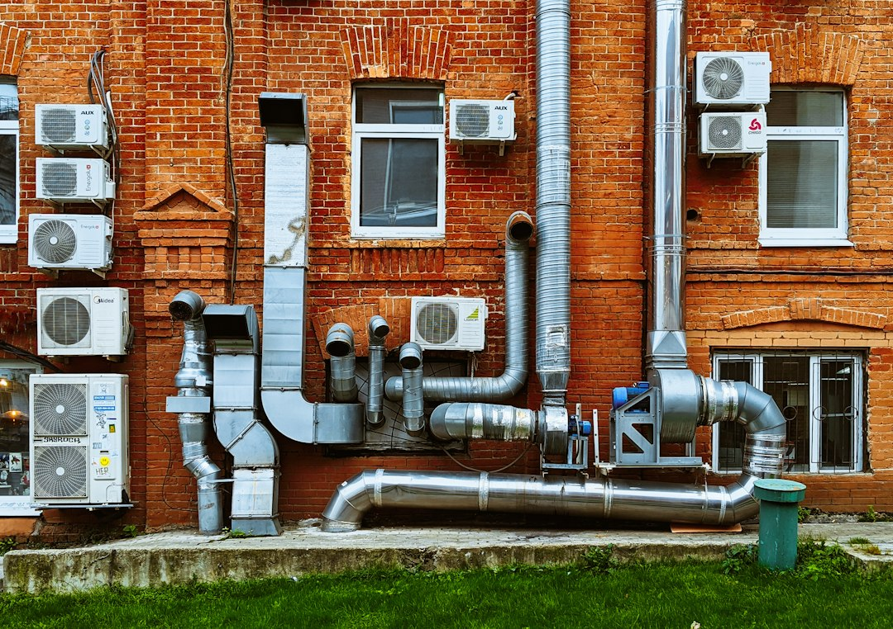

*This article is informational only. It contains no affiliate links, no product recommendations, and no paid placements. Its purpose is to help you understand your return air path well enough to observe it, take useful notes, and have a better conversation with a qualified HVAC professional.*

Most homeowners know where the warm or cool air comes out. Far fewer know where it goes back in. The return side of a forced-air system is half of the airflow loop, and problems there can show up as weak airflow, noise, rooms that never reach the thermostat setting, doors that behave strangely, or a system that seems to run constantly.

The return path is also easy to misunderstand. Online advice often reduces it to a single rule of thumb, such as a fixed number of returns per room or a "correct" grille size. Real systems do not work that way. How much air a return path can carry depends on the actual open area, the filter, the length and fittings of the duct, the blower, and the total pressure the system works against.

This guide is not a duct engineering tutorial, and it will not tell you to cut, add, or resize anything. It explains how the return side works, shows one arithmetic example with its units handled correctly, and focuses on what you can safely observe, record, and ask a professional to measure.

Photo by [Vadim Babenko](https://unsplash.com/@vakerbv?utm_source=artlines_blog&utm_medium=referral) on [Unsplash](https://unsplash.com/?utm_source=artlines_blog&utm_medium=referral)

## What the Return Side Does and Why It Matters

A forced-air system is a loop. The blower pulls air in through the return path, which usually includes one or more grilles, a filter, and return ductwork. It pushes that air across a heating or cooling coil or heat exchanger and delivers it through supply ducts. Whatever volume leaves through the supply side has to come back through the return side, through leaks, or through gaps in the house, because air has nowhere else to go.

When the return path is restrictive, the blower faces more resistance. HVAC professionals call the total resistance the system works against *external static pressure*. It is measured in inches of water column with a manometer, and it includes the supply ductwork, return ductwork, filter, coil, grilles, and everything in between. A restrictive return is one way that number can climb.

What happens next depends on the equipment. Some blowers are designed to hold airflow roughly constant as resistance changes, and they may draw more power while doing so. Other blowers simply move less air as resistance rises. Either way, the possible symptoms overlap:

- Reduced airflow at supply registers
- More air noise at the return grille or in the ductwork
- Longer run times to reach the set temperature
- A coil that gets colder than intended in cooling mode, or a heat exchanger that gets hotter than intended in heating mode, if airflow is low enough

The same symptoms can come from a dirty coil, a failing blower component, leaky ducts, or a supply-side problem, so you cannot diagnose the return path from symptoms alone. That is why this guide emphasizes recording what you see and asking for measurements.

The U.S. Department of Energy's [air conditioning overview](https://www.energy.gov/energysaver/air-conditioning) covers central system basics, including maintenance and the importance of a properly designed and installed system. The [ENERGY STAR duct sealing page](https://www.energystar.gov/saveathome/heating-cooling/duct-sealing) discusses how leaky ductwork can undermine comfort and efficiency and generally points homeowners toward qualified professionals for the work. Neither page gives a return grille sizing recipe, and this article does not pretend otherwise.

## A Dimensional Example, and Why It Is Not a Sizing Recommendation

The relationship between airflow, velocity, and area is usually written as:

**Q = V × A**

Here Q is airflow in cubic feet per minute (CFM), V is air velocity in feet per minute (FPM), and A is area in **square feet**. Because duct and grille dimensions are usually measured in inches, it is common to convert:

**Area (square inches) = 144 × CFM ÷ FPM**

Suppose a system moves 2,000 CFM and you want to know what area would produce 700 FPM:

- 2,000 ÷ 700 = 2.86 square feet
- 2.86 square feet × 144 = roughly 411 square inches

So at 700 FPM, 2,000 CFM corresponds to about 411 square inches of *effective* area. A 14-inch by 10-inch opening is only 140 square inches. Pushed through that opening, the same airflow would imply a velocity of roughly 2,000 FPM, nearly three times higher.

Read this example for what it is: a demonstration of units and arithmetic. It is **not** a sizing recommendation for your home, for three reasons.

**Nominal size is not free area.** The dimensions printed on a grille or filter frame describe the opening in the wall or ceiling, not the open area air can pass through. Bars, louvers, a filter frame, and the filter media all reduce effective area. Two grilles with the same nominal dimensions can have very different free areas and resistance.

**Velocity is only one input.** Real return performance depends on filter pressure drop, the equivalent length of the duct run, elbows and transitions, the static pressure the blower can work against, and the manufacturer's blower performance data. A return that looks fine on paper can still perform poorly because of a tight elbow or a high-resistance filter.

**Your actual airflow is unknown without measurement.** The blower speed tap, the equipment model, the duct system, and the filter condition all affect real CFM. A capacity number on a data label does not tell you what your system is moving today.

Low velocity is not automatically "inefficient," and more return area is not automatically "better." Velocity targets are design tools for managing noise and pressure drop, balanced against space, cost, and the rest of the system. Judging whether your return path is adequate takes a manometer, the manufacturer's data, and the training to interpret both. The [ACCA technical manuals](https://www.acca.org/standards/technical-manuals) are where the industry's residential load calculation, equipment selection, and duct design methods are published, and they are written for trained practitioners rather than do-it-yourself sizing.

## Placement Principles a Homeowner Can Observe

Placement is where homeowners can contribute the most useful observations, even without tools. The goal is to let air leave occupied spaces and get back to the equipment without strong pressure differences between rooms. These patterns are worth recognizing.

**Where air has to travel.** A room with a supply register but no return grille has limited ways to send air back when its door is closed. Open doors, undercut doors, transfer grilles, and jumper ducts are all ways builders handle this. If a room behaves differently with its door closed, record it. That is a clue, not necessarily a reason to add anything.

**Returns and supplies working against each other.** If a return grille sits very close to a supply register in the same room, some conditioned air can travel straight from one to the other without mixing with the room. You may notice supply air that feels strong near the return and weak farther away. Note it.

**Exterior surfaces and nearby leakage.** A return located where the surrounding wall, ceiling, or floor cavity is leaky can pull in air from places you did not intend. You cannot see this directly, but you may notice dust streaking around a grille's edges, drafts near the grille when the system runs, or insulation fibers on the grille face. Record any of these. Sealing and repair belong to a professional, as the [ENERGY STAR duct sealing guidance](https://www.energystar.gov/saveathome/heating-cooling/duct-sealing) generally suggests.

**High or low grilles.** Return grilles are installed at many heights, and no single height is correct for every home. The better choice depends on the climate, the room, the equipment, and the design. If you want to know why yours is where it is, ask the contractor who evaluates your system.

**Obstructions.** Furniture, drapes, rugs, storage boxes, and decorative covers placed over or near a return grille can restrict airflow. This one you can observe and fix yourself, safely, by keeping clearance around the grille.

**Where returns may not go.** Building and mechanical codes restrict where return air can be drawn from, for safety reasons that include combustion safety and indoor air quality. Which locations are prohibited depends on your jurisdiction and the equipment in your home. Do not assume a location is acceptable because you have seen it elsewhere. Applicable codes and a qualified designer decide, and any new return opening should come from professional design, not a guess.

## Closed Doors and Pressure Between Rooms

Pressure differences between rooms are among the most noticeable effects of return path design, and they are often described backward. Here is the direction that matters.

Consider a bedroom with a supply register and no return grille. When the door is closed, the blower keeps delivering air into that room, but little can leave. The room tends to become **positive** relative to the hallway, and air leaks outward through the door gap, light fixtures, outlets, and other openings.

Now consider the area where the central return is located, often a hallway or common space. It draws air out continuously. If the closed bedrooms are not sending air back, that area can tend toward **negative** pressure relative to the rooms being fed. The two conditions usually go together.

Symptoms you may be able to observe include:

- A door that is hard to close, or that seems to push open or pull shut when the system starts
- A whistling or rushing sound at the door edge or undercut
- A noticeable temperature difference between a closed bedroom and the rest of the house
- A visible shift in a lightweight tissue held loosely near the door gap, with the door closed and the system running (observe only; do not block any air path with your hand or any object)

A bedroom that is warm or cold only with the door shut, and comfortable with it open, is a classic return path clue.

**Combustion safety matters here.** If your home has a fuel-burning appliance that draws combustion air from inside the house or relies on natural draft for venting, a strongly negative area can interfere with proper venting. This is called backdrafting, and it can pull combustion gases, including carbon monoxide, into the living space. You cannot judge this by feel. If you have any fuel-burning appliance, make sure working carbon monoxide alarms are installed and tested according to their instructions. If an alarm sounds, or you notice soot, a persistent combustion odor, or a flame that looks unusual, leave the building and call emergency services or your gas utility. Do not continue assessing the system.

## A Homeowner-Safe Assessment: Observe, Record, Ask

The steps below need only a notepad, a phone camera, and a flashlight. You do not open equipment, touch anything energized, or modify ducts. The aim is a written record you can hand to a professional.

1. **Find and photograph every return grille.** Walk the house and note where each return is, whether it holds a filter, and what surrounds it. Photograph each one from a distance and close up, including any labels. Count them, and note any grille that looks sealed, painted over, or disconnected. Do not remove covers that require tools or that open into equipment compartments.

2. **Record the filter specifications exactly as printed.** Filters carry their nominal dimensions, thickness, and often a MERV rating on the frame. Write these down for every filter location, along with the date of the last change, how dirty the filter looks, and the airflow direction arrow. Do not block, cover, or restrict a filter or grille by hand to test airflow. It tells you little and can stress the equipment. If a filter looks heavily loaded, replace it with the same specification before drawing conclusions, and record the before and after.

3. **Note noise, location, and timing.** Write down whether you hear whistling, rushing, rattling, or humming, where you hear it (at a grille, at a door, near the equipment), and when (at startup, constantly, only on a particular speed). A professional can use this to narrow down the cause.

4. **Run a closed-door comparison.** With the system running, spend a few minutes noting how each bedroom feels with its door open versus closed. Record which rooms change, which do not, and whether doors behave unusually. Do not wedge or tape anything over vents or gaps.

5. **Record comfort patterns over a few days.** Note which rooms run warmer or cooler than the thermostat setting, at what times of day, and in which season. Consistency matters more than any single reading.

6. **Check the combustion safety basics.** Confirm that carbon monoxide alarms are present, working, and placed according to their instructions. Note any fuel-burning appliances and whether they share a space with a return opening. Do not test venting yourself. Ask the professional about it.

7. **Assemble your questions and requests.** Take your notes and photos to a licensed HVAC professional and ask them to measure and explain, rather than simply recommend a larger grille. Useful items to request:
   - **Total external static pressure** measured with a manometer, compared with the equipment's rated range in the manufacturer's data
   - **Filter pressure drop**, and whether the installed filter type suits the return path
   - **Supply and return balance**, meaning whether the airflow leaving through supply registers is consistent with what the return path can carry
   - **Temperature split** across the coil or heat exchanger, interpreted using the manufacturer's data
   - **Room pressure with doors closed**, if you observed closed-door symptoms
   - **Combustion and backdraft safety testing** for any fuel-burning appliances, especially if closed-door or negative-pressure symptoms appeared
   - **Duct leakage**, if you noticed dust streaking or drafts near grilles

**When to stop:** Stop and call a professional, or emergency services where appropriate, if you smell gas or combustion products, hear a carbon monoxide alarm, see scorching or melted components, smell burning, or find water around the equipment. Do not open energized equipment panels, cut or modify ducts, or install new returns without professional design.

## Common Mistakes to Avoid

These are mistakes in interpreting and acting on return path information, not installation tips.

**Treating grille dimensions as capacity.** A grille's nominal size does not establish its free area or airflow capacity. Free area, the filter behind it, and the duct connection all matter. Do not compare grilles by the numbers on the frame and assume equal performance.

**Treating the equipment label as your actual airflow.** The label identifies the model and its electrical and capacity ratings. It does not tell you how much air your system moves in your house today. Actual airflow depends on the blower speed setting, the duct system, the filter, and the coil condition, and it takes measurement to know.

**Blocking a filter or grille by hand to "feel" the restriction.** It seems like an easy test, but it is not a measurement, and it can strain the equipment. Use the static pressure measurement a professional can take instead.

**Assuming more returns, or fewer, is always better.** There is no universal count. Some homes work well with a single central return and good transfer paths. Others need more. Adding returns does not inherently reduce efficiency, and low velocity is not inherently wasteful. The right answer depends on the whole system and the house.

**Generalizing about blower behavior.** Some blowers increase power draw to hold airflow as resistance rises, while others deliver less air. You cannot predict which applies to your system from the outside. Ask the technician what type of blower you have and how it responds.

**Using a filter that does not suit the system.** A very high-resistance filter on a return path not designed for it can raise static pressure. Do not guess. Check the manufacturer's guidance and ask the professional to measure the pressure drop with your current filter.

**Cutting, opening, or adding without design.** Cutting new openings into ducts, opening equipment panels, or adding returns without professional design can create combustion and air quality problems and can make airflow worse. This is a place to hire help.

**Ignoring combustion safety because comfort is the only complaint.** If closed-door symptoms involve a negative area near a fuel-burning appliance, the comfort issue can become a safety issue. Mention any such appliance to the professional explicitly.

## Frequently Asked Questions

**Do I need one return for every room?**
No. There is no universal rule of that kind. Some houses rely on a central return with open doors, undercuts, or transfer paths, and others use multiple returns. The right approach depends on the layout, the equipment, and the design. If a room has a comfort problem with its door closed, describe it to a professional and let them evaluate the options.

**How can I tell whether my return is too small?**
You cannot reliably tell from looking, because grille dimensions do not establish free area or capacity. Noise at the grille, weak supply airflow, long run times, and closed-door symptoms justify a professional measurement. The meaningful test is a total external static pressure measurement compared with the manufacturer's data, along with a look at filter pressure drop and duct layout.

**Is it normal for a closed bedroom to feel different from the rest of the house?**
It is common, especially when a room has supply air but no direct return path. Such a room tends to become positive relative to the hallway, and the central return area can be negative. Whether it is a problem depends on how large the effect is and what else it touches. Record it and ask a professional to check, especially if any fuel-burning appliance is in the house.

**Can a restricted return damage my equipment?**
Sustained high resistance can contribute to problems, but the specifics depend on the equipment and the severity. Some blowers move less air as resistance rises, which can affect coil or heat exchanger operation. Others draw more power to hold airflow. A professional can tell you which applies to your system and whether your measurements are within the manufacturer's range.

**Which filter should I use?**
Use the size and type that the equipment manufacturer and your HVAC professional specify. Record the dimensions, thickness, and MERV rating of your current filter. If you want to try a different type, ask the professional to check the pressure drop first rather than assuming a higher rating is better or worse.

**Can I turn a supply register into a return, or add a return myself?**
Not safely without professional design. Supply and return paths are designed differently, and changing them affects airflow, pressure, and combustion safety. Applicable codes and a qualified designer decide where returns can go. If you are considering a change, call a licensed contractor.

**How often should I check my filters and grilles?**
Check them regularly, and more often during heavy use, with pets, or after construction dust. Follow the manufacturer's guidance for your filter type, replace filters that look loaded, and keep clearance around every return grille.

**Will fixing the return path save energy?**
It may or may not. The effect depends on what is actually wrong and how the system is set up, so there is no universal savings figure. The benefit of measuring first is that you learn whether the return path is the problem before spending money on it.

## Conclusion

The return side of your HVAC system is easy to overlook and easy to misjudge. The airflow arithmetic is simple, but turning it into a sizing decision requires information a homeowner usually cannot get: free area, filter pressure drop, equivalent length, available static pressure, and the manufacturer's blower data. That is why the most useful thing you can do is observe carefully, record what you see, and ask for measurements.

Start with the basics. Photograph and count your returns, write down the filter specifications, note noise and closed-door behavior, and confirm your carbon monoxide alarms work. Then ask a licensed professional to measure total external static pressure, check supply and return balance, and evaluate combustion safety if you have fuel-burning equipment. The answers will tell you far more than any rule of thumb and will help you avoid paying for a change that does not address your actual problem.

For general background, the [U.S. Department of Energy's air conditioning guidance](https://www.energy.gov/energysaver/air-conditioning), the [ENERGY STAR duct sealing page](https://www.energystar.gov/saveathome/heating-cooling/duct-sealing), and the [ACCA technical manuals](https://www.acca.org/standards/technical-manuals) show how the industry frames system design, duct performance, and professional practice.

### Related Reading

Learn more about optimizing your ductwork and system balance:

- [How To Add A Return Air Vent Without Major Ductwork](/2026/05/28/how-to-add-a-return-air-vent-without-major-ductwork/)
- [HVAC Airflow Testing At Home Temperature Split CFM And Static Pressure](/2026/09/24/hvac-airflow-testing-at-home-temperature-split-cfm-and-static-pressure/)

---

  
<strong>About the Author</strong>

  
The HVAC Owners Manual team researches heating and cooling systems to help homeowners understand what's normal, what's not, and when to call a pro. Our guides are built from manufacturer documentation, industry standards, and contractor-community knowledge.

