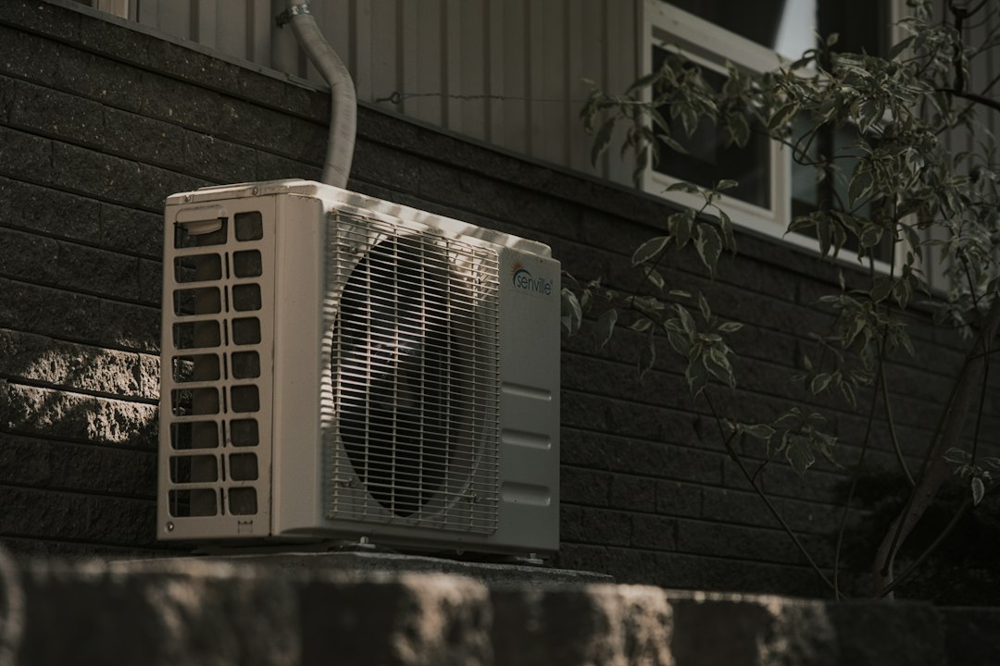

*This post contains affiliate links. As an Amazon Associate, I earn from qualifying purchases at no extra cost to you.*

Home additions often fall into a temperature dead zone. Your central AC system wasn't designed to reach the new space, ductwork routing becomes inefficient or impossible, and extending your existing system costs thousands. Ductless mini split systems solve this problem directly: they deliver cooling and heating to specific rooms without any connection to your main HVAC system.

A ductless mini split consists of an outdoor compressor unit connected via refrigerant lines to one or more wall-mounted indoor air handlers. No ductwork required. No reliance on your existing system's capacity. Each unit operates independently, letting you heat or cool your addition on its own schedule while maintaining different temperatures elsewhere in the home.

For home additions, this independence is valuable. You're not overloading a central system that wasn't sized to accommodate extra square footage. You're not running cooled air through lengthy ductwork and losing efficiency along the way. If your addition is in a separate zone, you gain independent temperature control - running the addition at 72 degrees while the rest of the house stays at 76.

Photo by <a href="https://unsplash.com/@everettp?utm_source=artlines_blog&utm_medium=referral">Everett Pachmann</a> on <a href="https://unsplash.com/?utm_source=artlines_blog&utm_medium=referral">Unsplash</a>

## Why Home Additions Need Separate Cooling and Heating

When you add a room, sunroom, or finished basement, your existing HVAC system faces two immediate problems: routing and capacity.

Central air conditioning distributes conditioned air through ductwork in walls and attics. If those ducts don't reach your addition, you have no cooling or heating - regardless of your system's capacity. Extending ductwork sounds straightforward but rarely is. Attic space fills with insulation, electrical wiring, and plumbing. Wall cavities are already framed. Running new ducts means cutting through structural members, rerouting utilities, and creating aesthetic compromises. When ductwork extension is possible, typical systems lose 15-30% of their cooling or heating capacity through air leaks and thermal loss.

Beyond routing is the capacity problem. Your central air conditioner was sized for your home's original square footage. Adding 300 square feet to a 2,000-square-foot home increases your cooling load by 15%. A system designed for the original footprint will struggle. Constant runtime shortens equipment life and wastes energy. Many older systems run at capacity every hot summer day, providing marginal comfort in the addition and increasing utility bills significantly.

A ductless mini split eliminates these problems. Refrigerant lines run through a small hole (typically 3 inches) in your exterior wall. The indoor unit mounts directly on the wall. You get full cooling and heating capacity for your addition without stressing your main HVAC system.

## How Ductless Mini Splits Work

Ductless mini splits use the same refrigeration cycle as central air conditioners, but without ducts. An outdoor unit (compressor and condenser) connects via small copper lines to an indoor wall-mounted unit (evaporator coil and blower). Refrigerant circulates between them, absorbing heat indoors and releasing it outdoors.

When cooling, liquid refrigerant in the indoor coil absorbs room heat. The vaporized refrigerant travels to the outdoor compressor, where it releases that heat. The cycle repeats continuously. In winter, the refrigerant flow reverses (heat pump mode) to extract outdoor heat and deliver it inside, even when outdoor temperatures fall below freezing. This reverse-cycle operation makes mini splits effective heaters in moderate climates and enables seamless switching between heating and cooling as seasons change.

Modern ductless systems achieve SEER ratings of 18-24 (verify specifications on the [AHRI Directory](https://www.ahridirectory.org/)), many qualifying for [EPA Energy Star certification](https://www.energystar.gov/products/cooling_heating/heat_pumps_air_source). They're dramatically more efficient than central air because they avoid ductwork losses: while typical central systems lose 15-30% of conditioned air before it reaches the room, mini splits deliver output directly into the space.

Most ductless systems feature variable-speed compressors that modulate based on demand. Instead of running at full capacity or shutting off completely, the compressor ramps smoothly upward or downward. On a mild day, the compressor runs at 30% capacity. As demand increases, it accelerates gradually. This modulation reduces energy waste, maintains consistent room temperature without dramatic on-off cycles, and lowers operating costs compared to single-speed systems. A model like the [Mitsubishi 30,000 BTU 2.5 Ton DUAL Zone Ductless Split System](https://www.amazon.com/dp/B0FQKKDJDT?tag=hvacowners-20) is a Hyper Heat, two-zone unit for conditioning multiple spaces.

## Sizing Your Ductless Mini Split

Choosing the right capacity is critical. Undersized systems won't keep pace on peak days. Oversized systems cycle on and off too frequently, wasting energy. Mini splits are measured in BTU (British Thermal Units) per hour.

Start with the room's square footage. A rough guideline is 10-12 BTU per square foot for average climates. A 300-square-foot addition would need roughly 3,000-3,600 BTU. However, several factors adjust this baseline significantly:

**Climate and sun exposure.** If your addition faces west and receives afternoon sun, add 10% to your BTU capacity. Heavily shaded or north-facing rooms subtract 10%. In hot climates (above 90°F summer design temperatures), add 15%. In cold climates (below 0°F winter design), ensure the unit has good low-temperature heating capability; many units lose heating capacity in extreme cold, so confirm AHRI ratings for your region.

**Insulation quality.** Well-insulated additions with good weatherstripping lose heat and cool air slowly. Poorly insulated spaces need higher capacity to compensate. New additions typically have modern insulation; older structures retrofitted as additions may not.

**Room use and internal heat load.** A home office generates far less heat than a media room with multiple people, TV, and gaming equipment. Conference rooms with video equipment need additional capacity. Account for appliances too: a mini kitchenette adds heat that your calculation might miss.

**Height and volume.** Vaulted ceilings increase the volume to condition, requiring more capacity. A 300-square-foot room with 8-foot ceilings is 2,400 cubic feet; the same footprint with 12-foot ceilings is 3,600 cubic feet.

**Humidity considerations.** High-humidity regions require systems that handle dehumidification efficiently. Some mini splits excel at this; others don't. If humidity control matters in your climate, ask contractors which models perform best.

Ductless systems come in 9,000 BTU (0.75 ton), 12,000 BTU (1 ton), 18,000 BTU (1.5 ton), and 24,000 BTU (2 ton) increments. If your calculation lands between sizes, round up. For multi-zone additions, consider a dual-zone outdoor unit connected to multiple indoor units, improving efficiency over separate systems and reducing installation cost since you need only one outdoor compressor and one hole in your exterior wall.

## Installation: Professional Approach and Proper Planning

Installing a ductless mini split involves more than mounting the indoor unit. Proper installation determines efficiency, longevity, and warranty validity.

**Safety warning:** Professional installation is strongly recommended. Refrigerant handling requires [EPA Section 608 certification](https://www.epa.gov/section-608-refrigerant-certification); improper handling releases ozone-depleting chemicals and is illegal. Electrical work must comply with local codes and may require permits. Attempting DIY refrigerant charging or electrical connection creates safety hazards and voids your warranty. Always hire a licensed HVAC contractor for refrigerant line work, vacuuming, and system charging.

**Refrigerant line routing and wall placement.** Copper lines connect the outdoor and indoor units through a small hole in your exterior wall. Lines must slope slightly downward (about 5 degrees) from the indoor unit to the outdoor unit to prevent oil pooling in the compressor. Refrigerant lines must be wrapped with foam insulation to prevent thermal loss and condensation.

Mount the indoor unit on an interior wall (not exterior), away from direct sunlight and heat sources. Exterior wall placement forces the system to cool against constant thermal load from outside, wasting 10-15% of capacity. Interior walls provide thermal insulation from outside temperatures.

**Condensate drainage and electrical requirements.** The indoor unit produces condensation that must drain away properly. A drain line slopes downward (at least 1/8 inch per foot) to an outside drain or pan. Mini splits require dedicated electrical circuits sized to the compressor's startup amperage - typically 208V or 240V service with a disconnect switch. This is not a standard outlet job; startup current can exceed 40 amps.

**Outdoor unit placement and airflow.** Position the compressor unit on a level concrete pad away from debris, direct sunlight, and heat-radiating surfaces. Keep it 12+ inches from walls or fences to ensure airflow around the condenser coil. Airflow restrictions force the system to work harder and waste energy. Units can operate effectively with refrigerant lines running 25-30 feet, though installation costs increase with distance.

**Professional handling and permits.** Many jurisdictions require permits for HVAC installation and refrigerant handling. A licensed technician obtains permits, vacuums the lines to remove air and moisture (critical step), charges the system with the correct refrigerant amount, and tests operation before leaving. Skipping the vacuum and charging step causes expensive compressor failures later.

## Planning Your Installation: A Step-by-Step Approach

1. **Calculate BTU needs.** Use the 10-12 BTU-per-square-foot baseline, adjust for climate, insulation, sunlight exposure, and internal heat load, then round up if you land between standard sizes.

2. **Determine outdoor unit location.** Identify a level concrete pad spot at least 12 inches from walls, away from direct sunlight, heat sources, and debris accumulation. Note if the location is far from the addition; long refrigerant lines increase labor cost but not efficiency.

3. **Select the indoor wall.** Choose an interior wall, away from direct sunlight and heat sources. Verify the location is reachable for filter maintenance and confirm no plumbing or electrical lines run behind it.

4. **Plan the refrigerant line route.** Trace a path from the outdoor unit to the indoor unit, avoiding attics, crawlspaces, and areas where rodents might damage insulation. Mark the location of the 3-inch wall hole; it should slope downward to the outdoor unit about 5 degrees.

5. **Get contractor quotes.** Provide your BTU requirement, location details, and preferences. Request quotes that include equipment, refrigerant lines, installation labor, permits, and warranty coverage. Compare 3-5 contractors.

6. **Review permits and electrical needs.** Confirm local permitting requirements and verify the system's voltage (208V or 240V) matches your home's service.

7. **Schedule during mild weather.** Spring or fall installation avoids peak cooling or heating season, making it easier to test the system properly and allowing contractors more availability.

## Common Mistakes to Avoid

**Undersizing to save money.** A 9,000 BTU system running at full capacity constantly will fail to maintain temperature on hot days. The compressor wears out faster and consumes more energy. Size correctly upfront.

**Mounting on an exterior wall.** Exterior placement forces the system to cool against constant thermal load from outside. You'll waste 10-15% of capacity and run the system harder than necessary.

**Uninsulated refrigerant lines.** Lines without foam insulation lose cooled or heated refrigerant and cause condensation to drip. Always wrap lines with rated insulation.

**Poor drainage.** Improper condensate drain slope causes water backup and leaks into walls or ceilings. The drain line must slope at least 1/8 inch per foot downward.

**Undersized electrical circuit.** Mini split compressors draw significant startup current. Never connect one to a shared outlet; use a dedicated circuit sized for the unit's requirements.

**Outdoor unit placement issues.** Surrounding the compressor with shrubs or debris prevents heat dissipation. Position it on the north or east side with clear airflow.

**Skipping vacuum and charging.** Air and moisture remaining in lines after installation degrades compressor oil and causes efficiency loss and premature failure. Professional installation with proper vacuum and refrigerant charging is critical.

**Neglecting filter maintenance.** Filters collect dust and must be cleaned monthly or replaced every 3-6 months. A clogged filter forces the evaporator coil to work harder, reducing capacity and wasting energy. Keep replacement filters like the [400x230x35mm Composite Filter, compatible with Daikin MC71NV2C series](https://www.amazon.com/dp/B0H8X29D96?tag=hvacowners-20) on hand.

## FAQ

**Q: Can a ductless mini split system provide backup power to other home systems?**

A: Standard ductless mini split systems require continuous grid power and cannot serve as a backup power source. If power outages are common, a backup power supply such as the [Krieger 1100 Watt 12V Power Inverter](https://www.amazon.com/dp/B00T564EIY?tag=hvacowners-20) may be an option for small loads, but confirm with a licensed electrician whether any inverter can safely handle your mini split before relying on it. For permanent backup capability, consult with a licensed electrician about integrating a mini split with a whole-home generator system, which requires specialized wiring and permits.

**Q: How long do ductless mini split systems last?**

A: A properly installed and maintained ductless mini split typically lasts 15-20 years, with some reaching 25 years. Maintenance is key: clean the indoor unit filter monthly, have the outdoor coil professionally cleaned annually, and keep both units free of debris. Regular refrigerant checks and seal inspections extend system life. If your system requires frequent repairs after 12-15 years, replacement often makes more financial sense than continued service costs.

**Q: Do I need a separate thermostat for my ductless mini split addition?**

A: Yes, ductless mini splits operate independently from your central HVAC system and require their own control. Most systems include a wireless remote control and wall-mounted thermostat. Modern units integrate with smartphone apps, letting you adjust the addition's temperature from anywhere. You cannot control a mini split from your central system's main thermostat; the two operate separately. This independence is beneficial because you can set the addition to a different temperature than the rest of your house.

**Q: What's the difference between a ductless mini split and a window air conditioner?**

A: Both condition individual rooms, but ductless systems offer superior efficiency and appearance. A window AC sits in a window frame, blocking views and requiring an external bracket. Ductless units mount flush on interior walls, occupying minimal visual space. Ductless systems achieve SEER ratings of 18-24, while window units typically reach SEER 14-15. Ductless also handles multiple zones from one outdoor unit, whereas window units condition only the immediate room. For permanent home additions, ductless systems outperform window units in efficiency, noise, and long-term value.

**Q: Will a ductless mini split work in my climate?**

A: Ductless mini splits work effectively in most climates, but performance varies. In cooling-dominant regions, they excel. In cold climates, confirm that the unit has good low-temperature heating capability by checking AHRI specifications for your region. Many models lose heating capacity in extreme cold (below -10°F), so if you're in a harsh winter climate, ask contractors for models rated for your minimum outdoor temperature. Dual-zone or multi-zone systems allow you to balance efficiency: run heating in zones you're using and leave others idle to reduce energy waste.

**Q: Can I install multiple indoor units on one outdoor compressor?**

A: Yes. A dual-zone or triple-zone outdoor compressor can support multiple indoor units, dividing refrigerant flow among them. This configuration reduces installation cost (one hole, one compressor pad, one electrical circuit) and improves efficiency by avoiding multiple compressors. Each indoor unit has its own thermostat and can be set to a different temperature. This is ideal for additions with multiple rooms or zones requiring separate control. Ensure your contractor properly sizes the outdoor unit for the combined BTU requirement of all indoor units.

## Conclusion

Ductless mini split systems solve the HVAC challenge that home additions create. They deliver full cooling and heating capacity without relying on your central system's ductwork, and they provide independent temperature control over new space. Sizing correctly, routing refrigerant lines properly, and ensuring professional installation set the foundation for reliable operation over 15-20 years.

For most additions, especially those far from the main trunk lines or in a different thermal zone, ductless mini splits are the better choice. They cost less than expanding ductwork, they operate more efficiently than overloaded central systems, and they give you the flexibility to condition only the spaces you use.

**Bookmark this guide or share it with a contractor to ensure your addition gets the cooling and heating it needs.**

### Related Reading

Planning a system upgrade? Our guide on [Ductless Mini Split Heat Pump Systems vs. Traditional HVAC](/2026/11/10/ductless-mini-split-heat-pump-systems-vs-traditional-hvac-when-they-make-sense/) breaks down when each system makes financial sense. You'll also find our comparison of [Central AC vs. Mini Splits](/2026/06/19/central-ac-vs-mini-split-which-right-home/) helpful for weighing long-term tradeoffs.

---

  
<strong>About the Author</strong>

  
The HVAC Owners Manual team researches heating and cooling systems to help homeowners understand what's normal, what's not, and when to call a pro. Our guides are built from manufacturer documentation, industry standards, and contractor-community knowledge.

