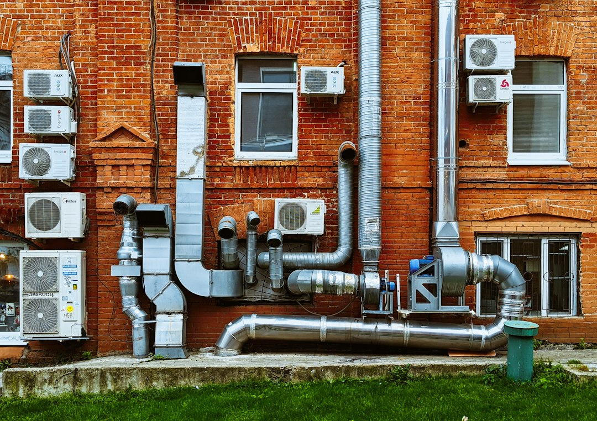

*This post contains affiliate links. As an Amazon Associate, I earn from qualifying purchases at no extra cost to you.*

Your HVAC system is one of the most expensive investments in your home. Unlike a car that reminds you with warning lights, your furnace or air conditioner just keeps running until something breaks - and breakdowns are almost always expensive and inconvenient. The difference between a system that lasts 15 years and one that fails at 10 is often maintenance. A well-maintained HVAC system runs more efficiently, keeps you comfortable year-round, and costs significantly less to operate. The U.S. Department of Energy reports that [regular maintenance can improve system efficiency by up to 15%](https://www.energy.gov/energysaver/heat-and-cool-efficiently), which translates to real savings on your energy bills. The good news is that HVAC maintenance isn't complicated. Most of it is routine: filter changes, occasional cleaning, and annual professional tune-ups scheduled at the right time of year. The key is doing the right thing at the right time. This guide walks you through a complete HVAC maintenance schedule - monthly tasks you can handle yourself, seasonal preparations before heating and cooling seasons, and annual professional service timing. You'll learn when to schedule a technician visit, what to expect from professional maintenance, and which DIY tasks actually matter. Following this schedule adds years to your system's life and keeps your home comfortable without the emergency calls.

Photo by <a href="https://unsplash.com/@vakerbv?utm_source=artlines_blog&utm_medium=referral">Vadim Babenko</a> on <a href="https://unsplash.com/?utm_source=artlines_blog&utm_medium=referral">Unsplash</a>

## Why Your HVAC Maintenance Schedule Matters

Preventive maintenance isn't optional - it's the cheapest way to keep your system reliable. When you skip maintenance, small problems grow into expensive repairs. A dirty air filter that reduces airflow by 20% makes your system work harder, driving up utility costs and accelerating wear on the blower motor. A condenser coil covered in debris can't transfer heat efficiently, making your air conditioner run longer and hotter, which damages the compressor - the most expensive component to replace. Professional inspections catch these issues before they cascade into failure.

Regular maintenance also keeps your warranty valid. Most HVAC manufacturers require annual professional service to honor coverage. Skipping maintenance gives them legal grounds to deny a claim on a failed part - a risk not worth taking on equipment that costs $5,000 to $15,000 to replace.

The frequency of service varies by season and system age. New systems under five years old with quality filters may need less frequent attention than older units. Changing your maintenance schedule based on the season also matters: furnaces need a tune-up before winter, and air conditioners need preparation before summer. Getting the timing right ensures your system is ready when you need it most. A system maintained on schedule fails less often, runs more efficiently, and outlasts one neglected until problems force action.

**Professional maintenance** should happen twice per year: once in fall (September or early October) before heating season, and once in spring (March or April) before cooling season. This is the industry standard, and manufacturer recommendations almost always specify biannual service according to [AHRI standards](https://www.ahridirectory.org/). During a professional visit, a technician inspects the entire system, tests refrigerant levels, checks electrical connections, cleans coils, lubricates moving parts, and checks for leaks or wear. This visit typically costs $150–$300 per service, but catching a small leak or worn bearing in October can save you a $2,000+ repair in January.

**Timing matters.** Fall maintenance is critical for furnace reliability. Heating systems work hard all winter, and a pre-season check ensures the burner ignites reliably, gas valves operate correctly, and airflow is optimal. Spring maintenance prepares your cooling system for summer and gives you time to address issues before peak cooling season begins. Technicians are less busy in shoulder seasons, so you'll get faster appointments and possibly better pricing than if you wait until peak demand.

**Monthly and seasonal checks** are your responsibility. These are simple but essential: filter changes every 1–3 months depending on filter type and your home's dust load, visual inspections of outdoor condenser units, and thermostat checks to ensure temperature accuracy. Most homeowners underestimate how much these small tasks matter. A single missed filter change can reduce efficiency by 10% for a month, wasting energy dollars that compound if neglect continues.

## Seasonal HVAC Maintenance Checklist for Every Season

Following a seasonal checklist ensures you never miss critical maintenance and spreads tasks throughout the year in manageable chunks.

**Fall (September - October): Prepare for Heating Season**

Before you flip your furnace from air conditioning to heating mode, perform these checks. Schedule your professional furnace tune-up early - don't wait until November when technicians are backed up. Replace your furnace filter with a fresh unit; don't rely on the filter you used all summer. Test your thermostat accuracy by placing a separate thermometer next to it and comparing readings after 15 minutes. If you have a pilot light, ensure it ignites reliably and burns blue (yellow flames indicate combustion issues requiring professional attention). Inspect all visible vents and returns for obstructions like curtains or furniture blocking airflow. If your furnace runs on natural gas, do a safety smell-test near the furnace - gas has a distinct odor, and any leak should trigger an immediate professional inspection. Check that your carbon monoxide detector has fresh batteries and test it to confirm function.

**Winter (November - February): Maintain System Efficiency**

During heating season, your furnace may run continuously in cold snaps. Replace filters more frequently - possibly monthly if your system runs constantly. Check your thermostat daily to confirm it's heating to your set temperature. If you have an outdoor heat pump, keep snow and ice cleared from the outdoor unit; ice buildup reduces airflow. Monitor your energy bills carefully; a sudden increase in heating costs often signals a efficiency problem worth investigating with a professional.

**Spring (March - April): Prepare for Cooling Season**

Before you switch to cooling, schedule your professional air conditioner tune-up. Replace your air filter with a fresh unit; winter debris may have built up. Clean or rinse your outdoor condenser coil with a garden hose on low pressure to remove winter dust and debris - do not use high pressure, which bends delicate aluminum fins. Inspect refrigerant line insulation (visible copper tubing) for cracks or damage. Turn on your AC and confirm cool air reaches your vents within 30 seconds. Clear the condensate drain line if it's accessible and check for proper water drainage outside.

**Summer (May - August): Maintain Peak Performance**

Replace filters every 1–3 months during heavy cooling use. Clear leaves, pollen, and debris from around your outdoor condenser unit regularly - summer storms can dump twigs and leaves. Listen for the system running smoothly; unusual rattling or grinding indicates wear. Check for refrigerant leaks by looking for oily residue around connections or listening for hissing sounds. Ensure airflow is consistent to all rooms; if some rooms aren't cooling evenly, blocked vents or ductwork problems may need attention.

## Monthly DIY HVAC Maintenance Tasks That Actually Make a Difference

You don't need an HVAC license to perform basic maintenance. The following tasks keep your system running and catch early problems before they become expensive failures.

### How to Replace Your Air Filter

1. Turn off your HVAC system at the thermostat or control panel.
2. Locate your filter compartment (usually in your furnace, air handler, or main return duct) and note the filter size printed on the existing filter.
3. Slide out the old filter and check the airflow arrow printed on the frame to ensure you install the new filter in the correct direction.
4. Insert your new filter with the airflow arrow pointing toward the furnace or air handler, and mark the installation date on the new filter with a pen for tracking.

Your filter type determines replacement frequency. Standard 1-inch fiberglass filters need changing every month during heavy use seasons, while [Filtrete 16x25x1 Smart Air Filter, MERV 12, MPR 1500](https://www.amazon.com/dp/B09RQCW3B7?tag=hvacowners-20) units are 3-month filters that let you track filter life with Bluetooth. A clogged filter reduces airflow, makes your system work harder, and wastes energy.

### How to Clean Your AC Condenser Unit

1. Turn off your air conditioning system at the thermostat.
2. Walk around your outdoor AC condenser unit or heat pump cabinet and remove visible debris like leaves, twigs, grass clippings, and twigs with your hands.
3. Use a garden hose set to low pressure and spray gently across the condenser fins from inside the unit outward; never use high pressure, which bends the aluminum fins.
4. Ensure plants and fences are at least 3 feet away from the unit in all directions to maintain adequate clearance for airflow.

This 10-minute task prevents airflow blockage and keeps your system efficient. Do not pressure-wash, which can bend the aluminum fins and reduce efficiency significantly.

### How to Check Your Thermostat Accuracy

1. Place a standard thermometer next to your thermostat on the wall at approximately the same height.
2. Let your HVAC system run for at least 15 minutes, then note the temperature reading on both your thermostat and the standard thermometer.
3. If the readings differ by more than 1–2 degrees, your thermostat may need recalibration or replacement. A smart thermostat like the [Honeywell Home T9 WiFi Smart Thermostat with 1 Smart Room Sensor](https://www.amazon.com/dp/B07N849J21?tag=hvacowners-20) is one option to consider as a replacement, and can help improve both comfort and efficiency.

**Clear condensate drain lines quarterly or when water backs up.** Locate your condensate drain line (usually a small plastic tube near your furnace or air handler indoors, or where water drips outside the house). If water isn't draining properly or you see algae buildup, flush it with a 50/50 white vinegar-and-water solution. This prevents standing water that can damage your system or your home's structure.

**Listen for unusual sounds while your system runs.** Grinding often indicates a failing blower motor bearing. Squealing suggests a worn belt. Rattling might be loose debris, loose fasteners, or bent fins. Hissing or bubbling indicates refrigerant leaks. Note the sound, when it occurs, and mention it to your technician - these catches catch failures early before they strand you in winter or summer.

## Professional vs. DIY Maintenance: Know the Boundary

Not all maintenance is DIY-friendly. Knowing the boundary prevents costly mistakes, protects your warranty, and keeps you safe.

**Professional technicians must handle:** refrigerant work (federal law requires EPA certification), electrical system repairs, gas line modifications, compressor replacement, and detailed diagnostics with specialized tools. These tasks carry safety risks and legal requirements that require licensing. Attempting them yourself voids your warranty and risks injury.

**You can safely do:** filter changes, visual inspections, outdoor unit cleaning, thermostat testing, condensate drain flushing, and removing visible debris. These require no special certification and take less than an hour per task. These are low-risk tasks that improve efficiency without requiring specialized equipment.

**When in doubt, call a professional.** If you notice leaking refrigerant, electrical sparks, burning smells, unusual system sounds, or system failures, stop and contact an HVAC technician. Attempting these repairs yourself risks injury and voids your warranty.

**SAFETY WARNING:** If you have a gas furnace, ensure your home has a functioning carbon monoxide (CO) detector on every level - basement, main floor, and bedrooms. Test detectors monthly and replace batteries annually. CO detectors protect against dangerous leaks from furnace combustion chamber cracks or improper venting. If your CO detector alarms, leave your home immediately, call 911 from outside, and do not re-enter until emergency services confirm safety. Any sign of combustion odors, pilot light won't stay lit, or yellow (instead of blue) burner flames indicates a professional inspection is needed immediately - do not attempt to troubleshoot these issues yourself.

## Common HVAC Maintenance Mistakes That Damage Your System

Even well-intentioned homeowners make errors that damage systems or undermine maintenance benefits. Avoiding these common pitfalls protects your investment.

**Mistake 1: Ignoring filter changes.** A clogged filter doesn't just waste energy - it causes airflow starvation that can freeze evaporator coils in summer or cause furnace overheating in winter. Many homeowners think "out of sight, out of mind" and never check their filter. Set a phone reminder for every 30 days during heating or cooling season. Mark the date on your filter when you install it so you know when replacement is due. If you have pets or live in a dusty area, check monthly; if your home is clean, every 3 months may suffice. This single task prevents more problems than any other.

**Mistake 2: Scheduling professional service at the wrong time.** Waiting until January to book a furnace tune-up means waiting weeks in the cold while technicians manage emergency calls. Scheduling in October or November ensures you're ready before the rush. Similarly, air conditioner maintenance should happen in March or April, not during the July heat wave when every technician is booked solid. Plan ahead and schedule services 4–6 weeks before peak season begins.

**Mistake 3: Blocking your outdoor condenser unit.** Leaves, shrubs, mulch piles, and fences within 3 feet of your condenser reduce airflow, which makes your AC work harder and shortens its life. Your system can't cool efficiently when the outdoor unit can't breathe. Keep the area clear. Trim back vegetation by at least 3 feet in all directions. This simple task improves cooling efficiency by 10–15%.

**Mistake 4: Using the wrong filter type or size.** Buying the cheapest fiberglass filter is tempting, but low-MERV filters let more dust pass through and don't improve air quality. Standard MERV 8–11 filters balance cost and airflow; if you have allergies, pets, or dust concerns, MERV 12–13 filters capture more particles without restricting airflow excessively. Always check your system's filter size before buying - wrong dimensions mean reduced airflow and increased system strain. An undersized filter leaves gaps, and an oversized filter won't fit. The correct size is usually printed on your furnace or air handler near the filter slot.

**Mistake 5: Skipping annual professional service to save money.** Saving $300 on an annual tune-up can cost $2,000+ when a minor leak becomes a major refrigerant loss, or a worn bearing seizes the compressor. Professional service extends system life, keeps your warranty valid, and usually prevents emergency repairs. The math favors maintenance every time. A $300 investment prevents an average $1,500 repair and extends system life by years.

**Mistake 6: Not maintaining consistent thermostat settings.** Constantly changing your thermostat temperature makes your system cycle inefficiently, wasting energy and causing wear. Set a reasonable temperature (68°F in winter, 76°F in summer) and stick with it. Programmable thermostats eliminate guesswork - they automatically adjust schedules so your system works efficiently when you're away and ramps up when you return. This consistency reduces cycling and saves energy.

**Mistake 7: Cleaning the condenser coil with high pressure.** The aluminum fins on outdoor condenser units are delicate. High-pressure washers bend fins, reducing airflow and efficiency significantly. Use a garden hose on low pressure or a soft brush instead. If fins are severely bent or corroded, leave coil cleaning to a professional with proper tools.

### HVAC Maintenance Schedule Reference: What, When, and Who Does It

| Task | Frequency | DIY or Pro | Time Required | Notes |
|------|-----------|-----------|----------------|-------|
| Replace air filter | Every 1–3 months | DIY | 5 minutes | More often with pets or high dust load |
| Inspect outdoor unit for debris | Monthly (summer) or as needed | DIY | 10 minutes | Remove leaves, twigs, and obstructions |
| Check thermostat accuracy | Quarterly or seasonally | DIY | 10 minutes | Use a separate thermometer for comparison |
| Clear condensate drain line | Quarterly or if backed up | DIY | 15 minutes | Use vinegar-water solution if clogged |
| Professional furnace tune-up | Once per year (fall) | Pro | 1 hour | Schedule September - October before heating season |
| Professional AC tune-up | Once per year (spring) | Pro | 1 hour | Schedule March - April before cooling season |
| Clean condenser coil | Annually or as needed | DIY/Pro | 30 min–2 hours | DIY with garden hose; Pro for deep cleaning |
| Refrigerant level check | Every 2 years or if cooling drops | Pro | 30 minutes | Necessary if you notice reduced cooling |
| Electrical connection inspection | Annually (professional only) | Pro | 15 minutes | Part of standard tune-up visit |
| Belt and bearing lubrication | Annually (professional only) | Pro | 15 minutes | Part of standard tune-up visit |

## FAQ

**Q: How often should I have my HVAC system professionally serviced?**

A: Twice per year is the industry standard and manufacturer recommendation. Schedule one visit in fall (September - October) before heating season and one in spring (March - April) before cooling season. Some newer systems with excellent maintenance records might extend to annual service, but biannual maintenance is safest. Professional service typically costs $150–$300 per visit and catches small issues before they become expensive repairs. Skipping professional service is false economy - the $300 saved on maintenance often leads to $2,000+ emergency repairs later. Most system manufacturers void warranties if you skip recommended maintenance, leaving you unprotected if major components fail.

**Q: What's the most important HVAC maintenance task I can do myself?**

A: Filter replacement is the single most impactful DIY task. A clean filter keeps airflow optimal, reduces system strain, improves efficiency by 10–15%, and prevents dust and debris from damaging internal components. Replace filters every 1–3 months depending on dust load and filter type. Mark your calendar and set a phone reminder so you never miss it. This one simple task extends your system's life more than any other single action. A neglected filter can reduce cooling or heating capacity by 20%, forcing your system to run much longer and harder, accelerating all component wear.

**Q: Why does my HVAC maintenance schedule need to be seasonal?**

A: Your HVAC system cycles differently in summer and winter. Furnaces work heavily in winter and need a pre-season inspection to ensure reliability when you depend on them most. Air conditioners work heavily in summer and need similar preparation. Seasonal maintenance ensures your system is ready before peak demand and catches wear patterns specific to each season. Fall preparation prevents mid-winter breakdowns; spring preparation does the same for summer cooling. A furnace that hasn't been inspected since spring may have pilot light or ignition problems that surface the first time you use it in winter. Similar issues can prevent an AC system from cooling effectively the first time you need it in summer.

**Q: Can indoor humidity management improve my HVAC efficiency?**

A: Yes, significantly. In winter, low indoor humidity (below 30%) forces your furnace to work longer because dry air feels colder than moist air at the same temperature. A [Levoit LV600HH 6L Warm&Cool Mist Humidifier](https://www.amazon.com/dp/B08FHZTYJB?tag=hvacowners-20) helps with local humidity control, but a whole-home humidifier built into your HVAC system maintains consistent 30–50% humidity throughout your home, reducing furnace cycling and improving comfort. Portable units work for specific rooms but don't reduce system workload overall. Humidity management is an often-overlooked efficiency factor that improves both comfort and equipment lifespan.

**Q: Is preventive HVAC maintenance really worth the cost?**

A: Yes, absolutely. Preventive maintenance typically costs $300–$600 per year but prevents emergency repairs costing $1,000–$3,000+. Studies from the U.S. Department of Energy show that regular maintenance improves efficiency by up to 15%, which covers the maintenance cost in energy savings alone. Plus, maintenance extends system life by 3–5 years, keeping expensive replacement at bay. Mathematically and practically, preventive maintenance always wins. The average HVAC system costs $5,000–$15,000 to replace; maintaining one properly costs around $600 per year and adds years to its life.

## Conclusion

Your HVAC maintenance schedule is the difference between a system that lasts 15+ years and one that fails at 10. The work itself is simple: monthly filter changes, seasonal checks, and two professional tune-ups per year. None of these tasks is complex or expensive, and together they add years to your system's life, keep your home comfortable, and lower your energy bills. The hardest part isn't the work - it's remembering to do it consistently. Set phone reminders for filter replacement. Mark your calendar for fall furnace tune-ups and spring AC service in September and March. These small habits protect your largest home investment and prevent the stress of emergency breakdowns. Start this month: check your air filter today, note when it's due for replacement, and schedule your next professional service. Your future self will thank you when your system runs reliably through another winter or cooling season without fail.

**If this guide helped, bookmark it for seasonal reference or share it with someone managing their own HVAC system.**

Learn more about extending your system's reliability in our guides on [how to extend the life of your HVAC system](/2026/06/12/how-to-extend-the-life-of-your-hvac-system/) and [the best HVAC maintenance tools every homeowner should own](/2026/06/30/best-hvac-maintenance-tools-every-homeowner-should-own/).

---

  
<strong>About the Author</strong>

  
The HVAC Owners Manual team researches heating and cooling systems to help homeowners understand what's normal, what's not, and when to call a pro. Our guides are built from manufacturer documentation, industry standards, and contractor-community knowledge.

