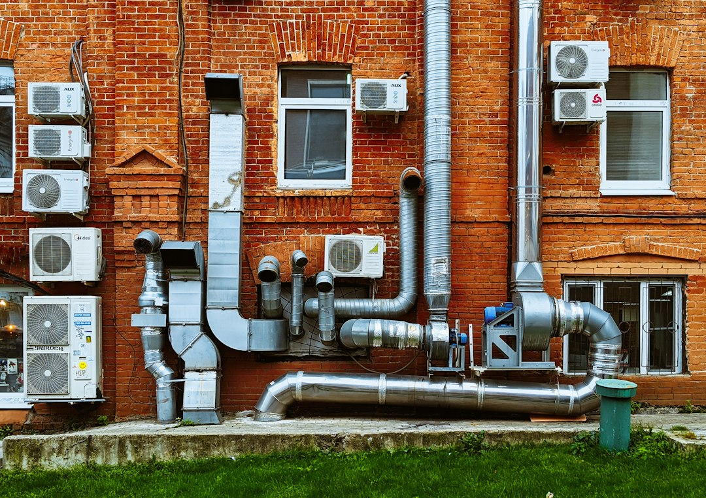

*This post contains affiliate links. As an Amazon Associate, I earn from qualifying purchases at no extra cost to you.*

Sizing your HVAC system correctly is the single most important decision you'll make when replacing or installing new heating and cooling equipment. An undersized system runs constantly without reaching your desired temperature. An oversized system cycles on and off too frequently, wasting energy and leaving your home with uneven comfort. Both extremes shorten equipment life and drive up utility bills.

Yet many homeowners remain confused about tonnage, BTU ratings, and how to determine what their home actually needs. You'll see online calculators that contradict each other, contractors who size by gut feeling, and conflicting advice about whether 1 ton per 500 square feet or 1 ton per 400 square feet is correct. The truth is that proper sizing depends on multiple variables: your climate zone, the home's insulation quality, window area and orientation, air leakage, and occupancy patterns.

In this guide, you'll learn the industry-standard method for calculating HVAC requirements, understand the practical adjustments that make sizing accurate for your specific home, and recognize when you should hire a professional for a detailed Manual J load calculation. By the end, you'll know exactly what to look for in specifications and how to verify that a contractor's recommendation makes sense.

Photo by <a href="https://unsplash.com/@vakerbv?utm_source=artlines_blog&utm_medium=referral">Vadim Babenko</a> on <a href="https://unsplash.com/?utm_source=artlines_blog&utm_medium=referral">Unsplash</a>

## Understanding Tonnage and BTU Ratings

HVAC systems are rated in **tons** for air conditioning and cooling, and **BTU per hour** for heating capacity. One ton of cooling equals 12,000 BTU per hour. So a 3-ton air conditioner removes 36,000 BTU per hour from your home. Heating systems are often labeled in BTU (e.g., 80,000 BTU furnace), though some heat pumps are also rated in tons.

The confusion starts because tonnage is a legacy measurement from the ice age, when air conditioning capacity was literally based on how much ice was needed to cool a space. The term stuck. Today, tonnage and BTU are used interchangeably to describe cooling capacity, with tonnage being the standard for whole-home systems and BTU the standard for portable and window units, such as the [LG 10,000 BTU Dual Inverter Portable Air Conditioner](https://www.amazon.com/dp/B07NC2QM6V?tag=hvacowners-20).

A **ton of cooling** (12,000 BTU/hr) can typically cool about 400 to 500 square feet of conditioned space under average conditions. However, that rule of thumb is a starting point, not a prescription. Your actual requirement depends on how much heat your home absorbs and retains, and that varies dramatically by climate, insulation, and construction.

The industry standard for calculating true HVAC requirements is the **Manual J load calculation**, developed by the [Air Conditioning Contractors of America (ACCA)](https://www.acca.org/). Manual J considers 40+ factors including outdoor design temperature, indoor design temperature, solar gain, wall and roof construction, window performance, air infiltration, and internal heat loads (people, appliances, lighting). Professional Manual J calculations require licensed software and are performed during the design phase of a new installation or replacement.

For homeowners doing a rough estimate or evaluating a contractor's recommendation, you can use the baseline method: **15 BTU per square foot** for cooling in average climates. This gives you a reasonable starting point before adjustments.

## Calculating Baseline HVAC Tonnage Using Square Footage

Here's the practical step-by-step process for calculating baseline cooling and heating requirements:

1. **Measure your home's conditioned square footage.** Include all heated and cooled living space. Do not count unconditioned garages, attics, or basements unless they're finished and you intend to condition them. If you have a two-story home, add the square footage of each floor. For an irregular layout, break the home into rectangles, calculate each area, and add them.

2. **Multiply conditioned square footage by 15 BTU to find baseline cooling capacity.** A 2,000 sq. ft. home: 2,000 × 15 = 30,000 BTU = 2.5 tons. Round up to the nearest 0.5-ton increment, which gives you 2.5 to 3 tons. This is your starting point.

3. **Determine your climate zone's design temperature spread.** The cooling load is higher in hot climates (Arizona, Florida, Texas) and lower in mild climates (Pacific Northwest, Northern tier states). The [ASHRAE](https://www.ashrae.org/) standard defines summer cooling design temperatures: typically 95°F for hot climates, 85–92°F for moderate climates, and 78–82°F for cool climates. If you live in a very hot area, your requirement may be **18 to 20 BTU per square foot**. If you live in a mild climate, **12 to 14 BTU per square foot** may be adequate.

4. **Recalculate with your climate adjustment.** Using 18 BTU/sq. ft. for a hot climate: 2,000 sq. ft. × 18 = 36,000 BTU = 3 tons. Using 12 BTU/sq. ft. for a mild climate: 2,000 sq. ft. × 12 = 24,000 BTU = 2 tons.

5. **Record the result.** Your baseline tonnage is now climate-adjusted. Write it down; you'll refine it further in the next section.

This method works best for homes built in the last 20 years with average insulation. Older homes and newer high-efficiency homes require additional adjustments.

## Adjusting for Home-Specific Factors

Once you have a baseline tonnage, adjust for factors that increase or decrease the actual cooling load:

**Insulation Quality**

Homes with poor attic insulation (fewer than 6 inches), uninsulated basement walls, or aging walls with no cavity insulation lose conditioned air faster. These homes need **10–15% larger capacity**. Homes with modern insulation (R-38 attic, R-15 basement walls, spray foam in cavities) use **10–15% less capacity**.

**Windows and Solar Gain**

Windows facing south and west absorb intense afternoon sun. A home with large south or west-facing windows needs **5–10% additional capacity**, especially if the windows lack low-emissivity (Low-E) coatings or external shading. North-facing windows contribute little heat gain. East-facing windows moderate the morning sun.

**Air Leaks and Infiltration**

Modern homes are built with blower doors in mind and are tested to achieve air-leakage rates. Older homes (pre-2000) may leak significantly around gaps, poorly sealed ductwork, and foundation cracks. Leaky homes require **5–10% more capacity** because conditioned air escapes and unconditioned outside air enters continuously.

**Occupancy and Internal Load**

A home with 4 people generates more heat (body heat, appliances, lighting) than a home with 1 person. Add **5% per additional occupant** if your home regularly hosts more than two people. A home with a commercial kitchen or home office with multiple servers and work lights may need **3–5% extra**.

**Attic Ventilation and Ductwork Location**

If your air-conditioning ducts run through an unconditioned attic, they lose efficiency as outside air heats the ductwork. Add **5–10%** to account for distribution losses. Modern homes with sealed attics and properly insulated ducts don't incur this penalty.

**Example: Adjusting a 2,000 sq. ft. home**

Start with baseline: 2,000 sq. ft. × 15 BTU = 30,000 BTU = 2.5 tons (adjusted to 3 tons for a hot climate).

Adjustments:
- Poor attic insulation: +10% = +3,000 BTU
- Large south windows, no Low-E coating: +8% = +2,400 BTU
- Old home, moderate air leaks: +8% = +2,400 BTU
- Ductwork in attic: +8% = +2,400 BTU
- Three occupants (average): +5% = +1,500 BTU

Total adjustments: +10,700 BTU. New requirement: 30,000 + 10,700 = 40,700 BTU ≈ 3.5 tons.

Without these adjustments, a 3-ton system would run continuously and fall short on the hottest days.

## The 15 BTU Per Square Foot Rule and When to Exceed It

The **15 BTU per square foot** baseline is industry consensus for average North American homes in average climates. It assumes:
- Outdoor summer design temperature of 95°F
- Indoor cooling setpoint of 72–75°F
- Moderate insulation (R-19 walls, R-30 attic)
- Average solar gain
- Normal occupancy (2–3 people)
- Typical window area and orientation

This rule works because it balances cooling load across a broad population. But your home may not be average.

**When you exceed 15 BTU/sq. ft.:**
- Hot climates (Arizona, Las Vegas, South Florida) often require 18–20 BTU/sq. ft.
- Homes at high altitude experience lower air density, requiring slightly more capacity.
- Homes with excessive solar exposure (few trees, south-facing glass) may need 18+ BTU/sq. ft.
- Poorly insulated older homes require 17–18 BTU/sq. ft.
- Commercial-grade appliances or large internal heat loads (media server rooms, kitchens) bump the requirement up.

**When you can use less than 15 BTU/sq. ft.:**
- Mild climates (Pacific Northwest, Northern California) may need only 12–14 BTU/sq. ft.
- Homes with excellent insulation and air sealing (passive house standards, new construction with blower door testing).
- Homes with passive solar design (deciduous trees for summer shade, minimal west glass).
- Homes with exterior shading (deep eaves, pergolas, reflective film).

A wrongly applied rule is worse than no rule at all. Use 15 as your baseline, then adjust for your specifics.

## Common Sizing Mistakes and How to Avoid Them

**Oversizing the System**

Many contractors or big-box retailers recommend a system one size larger "for good measure." A 3,500 sq. ft. home might get sized for 4 tons instead of 3.5 tons. The system cools the home in 10 minutes instead of 20, then shuts off. It cycles frequently, running in short bursts that reduce efficiency, increase wear on the compressor, and prevent proper humidity removal. Short-cycling can halve the effective life of your equipment. An oversized system also costs more upfront and consumes more electricity.

**Undersizing the System**

Some contractors downsize to reduce cost or because they misread the calculations. An undersized system runs constantly on hot days without reaching your setpoint, frustrating occupants and driving up the electric bill. Worse, the system never dehumidifies properly. Humidity is removed during the cooling cycle; if the cycle is too short (because the home cools too fast), moisture lingers. An undersized system also experiences greater stress, shortening its lifespan.

**Ignoring Attic Conditions**

Contractors sometimes size based on the conditioned floor area alone, forgetting that ductwork in a 140°F attic loses 15–20% of its cooling capacity through the duct walls. The system appears undersized once installed. Always account for duct locations. If ducts are in the attic, add 8–12% to the baseline.

**Applying Rules of Thumb to Unusual Homes**

A ranch home and a 3-story Colonial with the same square footage have very different surface areas. The 3-story home has less perimeter-to-volume ratio, so it loses less heat/gains less cooling load. Applying 15 BTU/sq. ft. mechanically to both leads to oversizing the 3-story home and undersizing the ranch. Consider home configuration, not just area.

**Not Accounting for Future Changes**

If you plan to add a sunroom, finish a basement, or expand the master suite in the next 10 years, size accordingly now. Adding 200 sq. ft. of space later and discovering your system is now undersized is costly. A 5–10% buffer for future growth is reasonable.

**Mixing Cooling and Heating Sizing**

Cooling and heating loads are not proportional. A home that needs 3 tons of cooling in Arizona might need a 60,000 BTU furnace (5 tons equivalent) in Minnesota, because winter outdoor temps are much lower. Size cooling and heating independently using climate-specific design temperatures.

## HVAC Tonnage by Climate and Square Footage

Here's a practical reference table for average homes in different climates:

| Square Footage | Mild Climate (12–14 BTU/sq. ft.) | Moderate Climate (15 BTU/sq. ft.) | Hot Climate (18–20 BTU/sq. ft.) |
|---|---|---|---|
| 1,000 sq. ft. | 1–1.5 tons | 1.5 tons | 2–2.5 tons |
| 1,500 sq. ft. | 1.5–2 tons | 2 tons | 2.5–3 tons |
| 2,000 sq. ft. | 2–2.5 tons | 2.5–3 tons | 3.5–4 tons |
| 2,500 sq. ft. | 2.5–3 tons | 3–3.5 tons | 4–5 tons |
| 3,000 sq. ft. | 3–3.5 tons | 3.5–4 tons | 5–6 tons |
| 3,500 sq. ft. | 3.5–4 tons | 4–4.5 tons | 5.5–6.5 tons |
| 4,000 sq. ft. | 4–4.5 tons | 4.5–5 tons | 6–7 tons |

This table assumes average insulation and average occupancy. Adjust up or down based on the specific factors above. For example, a 2,000 sq. ft. home in a hot climate with poor insulation, high solar gain, and ducts in the attic might need 4 tons instead of 3.5.

For supplemental cooling in specific rooms, the [LG 10,000 BTU Dual Inverter Portable Air Conditioner](https://www.amazon.com/dp/B07NC2QM6V?tag=hvacowners-20) is a 10,000 BTU unit listed as cooling up to 500 sq. ft. If your whole-home system is slightly undersized or you want to boost a single hot room, a portable unit can bridge the gap.

For homes considering a ductless upgrade, a [Daikin 12,000 BTU Mini Split Heat Pump](https://www.amazon.com/dp/B0F2GPQ19X?tag=hvacowners-20) offers 1 ton of capacity (12,000 BTU), letting you right-size comfort for a specific room or area rather than forcing one system to handle a whole-house mismatch.

## Frequently Asked Questions

**Q: Can I calculate HVAC tonnage myself, or do I need a Manual J from a contractor?**

A: You can estimate using the method in this guide and make an informed decision. However, a formal Manual J load calculation is the industry standard and accounts for 40+ variables. For a new whole-home system, especially if the contractor is quoting multiple options, ask for a Manual J. For a replacement with the same ductwork and layout, the old system's nameplate tonnage is often a good starting point; if you were comfortable, stick with it. If you were always hot or cold, adjust by 0.5 tons. A professional calculation costs $200–$500 but prevents a $5,000+ sizing error.

**Q: Why does my contractor's quote say 3.5 tons when I calculated 3 tons?**

A: Common reasons include accounting for ductwork losses, attic location, a homes age and condition, or their company's standard approach. Ask the contractor to show their calculation or sizing worksheet. Reputable contractors can walk you through their logic. If they can't explain it or get defensive, that's a red flag.

**Q: Is a bigger system always more expensive to run?**

A: Oversized systems don't run longer (they reach setpoint fast and cycle off), but they cycle more frequently, which reduces efficiency and increases compressor wear. An oversized system uses 5–15% more electricity than a right-sized one because frequent cycling is less efficient than steady operation. An undersized system runs constantly and uses far more energy. Right-sizing saves money every month on your electric bill and extends equipment life.

**Q: What if my home is split-level or has unusual geometry?**

A: Measure conditioned space carefully, accounting for the actual heated and cooled area. If in doubt, calculate square footage for each level separately and add them. A split-level with 1,500 sq. ft. on the upper level and 1,500 on the lower is still 3,000 total. However, the way air distributes between levels matters; some contractors size the indoor unit capacity and outdoor unit to balance performance. Discuss your home's layout with the contractor and ask if they recommend a two-stage or modulating system to handle multiple zones.

### Conclusion
Sizing your HVAC system correctly requires knowing your home's square footage, local climate zone, and condition. Start with 15 BTU per square foot as your baseline, adjust for climate zone (12–20 BTU/sq. ft. range), then refine based on insulation, air leaks, windows, and solar exposure. The result is your target tonnage.

Most homeowners benefit from a professional Manual J load calculation when replacing a system, especially if they were never satisfied with comfort. For a rough estimate or to verify a contractor's recommendation, this guide gives you the knowledge to ask the right questions and spot a poorly sized proposal.

Your properly sized system will keep your home comfortable, run efficiently, last longer, and save you money every month. That's worth getting right.

---

**Keep your HVAC system running at peak efficiency.** [Subscribe to our blog](#) for tips on maintenance, repairs, and upgrades, or [check out our guide to extending your HVAC system's life](/2026/06/12/how-to-extend-the-life-of-your-hvac-system/).

---

### Related Reading
- [Central AC vs. Mini Split: Which Is Right for Your Home?](/2026/06/19/central-ac-vs-mini-split-which-right-home/) — Learn how different system types affect performance and efficiency once you've determined your tonnage.
- [How to Check and Improve Airflow to Every Room in Your House](/2026/08/20/how-to-check-and-improve-airflow-to-every-room-in-your-house/) — A properly sized system requires proper distribution; this guide shows you how to balance airflow across zones.

---

  
<strong>About the Author</strong>

  
The HVAC Owners Manual team researches heating and cooling systems to help homeowners understand what's normal, what's not, and when to call a pro. Our guides are built from manufacturer documentation, industry standards, and contractor-community knowledge.

