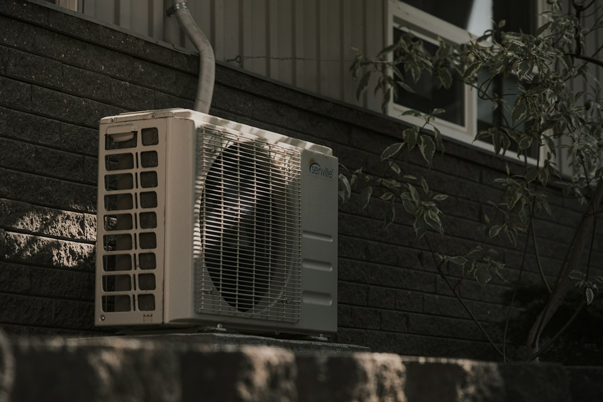

*This post contains affiliate links. As an Amazon Associate, I earn from qualifying purchases at no extra cost to you.*

Your system fails on the hottest day of July or the coldest night of January, and the technician hands you a quote that makes your stomach drop. Repair or replace? The decision usually gets made under pressure, with limited information, and a bad call costs thousands either way. Replace too early and you spend money on equipment with years of life left. Repair too late and you keep paying for a unit that fails again next season.

This guide takes a clear position: age and repair cost decide most cases, and everything else is a tiebreaker. If your equipment is past roughly two-thirds of its expected life and the repair approaches half the cost of replacement, start pricing new equipment. If the system is young, correctly sized, and the failure is a single common part, repair it and move on. Safety failures, such as a cracked furnace heat exchanger, override every other consideration.

Below you will find the lifespan benchmarks, a simple cost calculation, a list of repairs that are worth making, the real upgrade case for efficiency and refrigerant, a decision table, and the mistakes that push homeowners to spend in the wrong direction.

Photo by <a href="https://unsplash.com/@everettp?utm_source=artlines_blog&utm_medium=referral">Everett Pachmann</a> on <a href="https://unsplash.com/?utm_source=artlines_blog&utm_medium=referral">Unsplash</a>

## HVAC Repair Versus Replacement Starts With Age and Lifespan

Age is the single most predictive factor, because mechanical parts wear out in clusters. A 6-year-old system with a failed capacitor has a part problem. A 17-year-old system with the same failed capacitor has an early warning that the compressor, blower motor, and control board are all running on borrowed time.

Planning ranges vary by climate, installation quality, and maintenance, but these are reasonable benchmarks:

- **Central air conditioner:** roughly 15 to 20 years
- **Heat pump:** roughly 12 to 15 years, since it works in both seasons
- **Gas furnace:** roughly 15 to 20 years, sometimes longer with good maintenance
- **Evaporator coil and condenser coil:** often 10 to 15 years, with coastal air and poor maintenance shortening that

Treat these as planning ranges, not guarantees. The [Department of Energy's central air conditioning guidance](https://www.energy.gov/energysaver/central-air-conditioning) generally treats equipment in the 10 to 15 year range as worth evaluating for replacement, mainly because efficiency standards have improved considerably since then.

Your system's age is printed on the data plate, usually on the side of the outdoor condenser or inside the furnace cabinet. The serial number encodes the manufacture date, and a quick search of the brand name plus "serial number date" will decode it. Do this before any contractor visit. A homeowner who knows the real age negotiates from a stronger position and spots inflated claims quickly.

Maintenance history matters too. A 14-year-old system with annual service records and clean coils is a better repair candidate than a 10-year-old system that has never had a filter changed on schedule. If you are not sure what a healthy service cadence looks like, the [HVAC maintenance schedule guide](/2026/11/17/hvac-maintenance-schedule-when-to-service-your-system-for-peak-performance/) lays it out by season.

One more age-related warning sign: repair frequency. A system that needed one repair in its first twelve years is behaving normally. A system that needed three repairs in the last two years is telling you the failure curve has turned upward, and each additional repair is a smaller bet on a shrinking return.

## Do the HVAC Repair Versus Replacement Math

Two rules of thumb give you a fast first answer. Neither is perfect, but together they keep you from making a decision on emotion.

**The 50 percent rule:** if a single repair costs more than half the price of a comparable new system, and the equipment is past the middle of its expected life, replace it.

**The $5,000 rule:** multiply the system's age in years by the repair quote. If the result exceeds $5,000, lean toward replacement. If it is below, lean toward repair.

Here is how to apply them step by step:

1. **Find the age.** Read the serial number on the data plate and calculate years in service.
2. **Get the repair quote in writing.** It should name the failed part, labor, and any refrigerant. A verbal "probably around a thousand" is not enough to do math with.
3. **Get a replacement quote for comparison.** Ask for a full system price, including the matching indoor coil or air handler, not just the outdoor unit.
4. **Run both rules.** Check whether the repair exceeds 50 percent of replacement, and whether age times repair cost exceeds $5,000.
5. **Add the hidden costs.** Include the likelihood of another failure within two years, the energy savings a new system would offer, and any rebates available.
6. **Decide on the combined picture.** If both rules point the same direction, you have your answer. If they disagree, move on to the tiebreakers below.

A quick worked example: your 14-year-old AC needs a $900 repair. Fourteen times $900 is $12,600, far above $5,000, so the rule says replace. Now take an 8-year-old unit with a $600 repair. Eight times $600 is $4,800, so repair it. The rule is blunt, but it gets the obvious cases right.

The tiebreakers are where judgment comes in. Replace when the system uses a refrigerant that is expensive to service, when comfort problems persist despite repairs, when your utility bills have climbed steadily, or when the equipment was oversized from the start. Repair when the failure is isolated, when you plan to sell soon, or when a replacement would trigger expensive ductwork changes you cannot afford this year.

Never skip the second opinion on a large quote. The [guide to evaluating HVAC contractors and estimates](/2026/11/08/best-hvac-contractors-what-to-look-for-in-estimates-and-qualifications/) explains how to compare bids so you are not just comparing totals.

## Repairs Worth Making and Failures That Signal Replacement

Not every breakdown is a verdict on the whole system. Some parts fail routinely and cost little relative to the equipment they protect. Others point to damage that no repair fully reverses.

### Repairs that are almost always worth it

These are low-cost, common failures that rarely justify replacing a healthy system:

- **Capacitors, contactors, and relays.** These are inexpensive wear items. If your outdoor unit hums but the fan will not spin, a failed capacitor is a leading suspect. The [capacitor replacement guide](/2026/09/22/how-to-replace-an-hvac-capacitor-safely-without-calling-a-technician/) covers the safety steps if you plan to do it yourself.
- **Thermostat problems.** A dead or miscalibrated thermostat can mimic a system failure. Before paying for a service call, rule it out.
- **Clogged condensate drain.** This causes shutdowns from float switches and water damage, and it is usually a cleaning job. See the [condensate drain line guide](/2026/10/08/condensate-drain-line-clogs-how-to-clear-them-and-prevent-buildup/).
- **Dirty coils and filters.** Poor airflow and heat transfer can look like a dying system. A clean filter and a clean condenser often restore performance. If your filter is the weak link, a deep pleated option such as the [Lennox X6673 MERV 11 20x25x5 two-pack](https://www.amazon.com/dp/B0FN5ZGT1Z?tag=hvacowners-20) fits only cabinets built for that thick size, so measure your filter slot before ordering.
- **Flame sensor and igniter.** Furnace no-heat calls are frequently a dirty sensor. The [flame sensor cleaning guide](/2026/08/25/how-to-clean-a-furnace-flame-sensor-safely/) shows the safe procedure.

Smart thermostats are also a legitimate "repair-adjacent" upgrade. A WiFi model like the [ecobee Smart Thermostat Premium](https://www.amazon.com/dp/B09XXS48P8?tag=hvacowners-20) can help with scheduling and energy savings. Check your system's wiring and compatibility first, because some setups need a power adapter or have no common wire.

### Failures that usually signal replacement

> **Safety warning:** Gas furnaces can produce carbon monoxide. Test your CO detectors monthly and replace batteries on schedule. If a detector alarms, or you suspect a cracked heat exchanger, shut off the furnace, leave the house, and call a licensed HVAC professional or your gas utility. Never bypass safety switches or keep running a unit you suspect is venting improperly. Refrigerant work requires EPA Section 608 certification and is not a DIY task.

These problems usually push the math toward replacement:

- **Cracked heat exchanger.** This is a safety hazard, and replacing the heat exchanger on an older furnace is rarely cost-effective. Read the [carbon monoxide and furnace safety guide](/2026/11/07/carbon-monoxide-and-furnace-safety-what-homeowners-need-to-know/) for warning signs.
- **Failed compressor.** On a system past mid-life, a compressor replacement often approaches the cost of a new outdoor unit, and the surviving components still carry their age.
- **Repeated refrigerant leaks.** Topping off a leaking system is a temporary fix at best. The [refrigerant leak guide](/2026/10/06/refrigerant-leaks-how-to-spot-them-and-know-when-to-call-a-professional/) explains when a leak repair makes sense and when it does not.
- **Failed evaporator coil on an old system.** Replacing the coil but keeping a 15-year-old condenser creates a mismatch risk and leaves you exposed to the next failure.

If your system short cycles, do not assume it is dying. The [short cycling guide](/2026/09/27/hvac-short-cycling-what-causes-it-and-how-homeowners-can-fix-it/) covers causes that are often fixable, including oversizing that no repair will cure.

## The Upgrade Case: Efficiency, Refrigerant, and Rebates

Sometimes the repair is affordable and the system still deserves retirement. Three factors build the strongest upgrade case.

### Efficiency gains

Federal minimum efficiency has risen over time, and today's new split-system air conditioners are rated in SEER2 under updated test procedures, with minimums that vary by region. An older 10 SEER system replaced by a modern unit can meaningfully reduce cooling energy use, though real savings depend on your climate, usage, duct condition, and electricity rates. The [SEER ratings explainer](/2026/09/13/seer-ratings-explained-what-they-mean-for-your-energy-costs/) walks through how to convert a rating into estimated dollars. ENERGY STAR's [heating and cooling guidance](https://www.energystar.gov/saveathome/heating-cooling) also helps you compare efficiency levels and understand when certified equipment is worth the premium.

Do not oversell efficiency, though. A high-SEER2 condenser connected to leaky, undersized ducts will underperform its rating. If your ducts lose air in the attic, the [duct sealing guide](/2026/09/17/how-to-seal-ductwork-leaks-with-mastic-and-tape-like-a-pro/) may save you more than a new outdoor unit.

### Refrigerant considerations

Systems that use R-22 are generally older than 2010 and increasingly expensive to service because the refrigerant was phased out of new equipment production. Refrigerant rules continue to evolve, and the EPA's [Technology Transitions program](https://www.epa.gov/climate-hfcs-reduction/technology-transitions) is moving new residential equipment toward lower global warming potential refrigerants. If you are replacing, ask your contractor which refrigerant the quoted system uses and whether it is a long-term standard for new equipment. If you are repairing an R-22 system, price the refrigerant first. A repair that needs several pounds of it can cost more than the part that failed.

### Rebates and incentives

Incentives change often. The federal efficiency tax credit for home improvements was scheduled to end for equipment placed in service after December 31, 2025, so do not assume it is available. State programs, utility rebates, and manufacturer promotions may still apply, and they can shift a borderline decision. The [rebates and tax credits guide](/2026/09/19/hvac-rebates-and-tax-credits-homeowners-should-know-about/) shows where to look, and you should confirm current terms with your utility and state energy office before signing.

### Replacement is also the time to rethink the system

A replacement is the right moment to ask whether the same equipment type still fits your home. If you have a poorly ducted addition, a heat pump or [ductless mini split](/2026/11/10/ductless-mini-split-heat-pump-systems-vs-traditional-hvac-when-they-make-sense/) may serve you better than replicating the old setup. If you are simply swapping a like-for-like cooling system, you may see listings such as this [3-ton Run Tru by Trane air conditioner](https://www.amazon.com/dp/B0CRL46F5K?tag=hvacowners-20). Treat any retail listing as a starting point for research, not a purchase decision. Confirm whether it is an outdoor condenser only, what indoor coil it must match, its SEER2 rating for your region, and whether the warranty requires professional installation. And do not pick a 3-ton size because your old unit was 3 tons. A Manual J load calculation should determine tonnage, since oversizing causes short cycling and poor humidity control.

## HVAC Repair Versus Replacement Decision Table

Use this table after you have the age, the quote, and a basic diagnosis. It condenses the logic above into a single lookup.

| Situation | System age | Repair cost vs. new system | Recommended action |
|---|---|---|---|
| Failed capacitor, contactor, or igniter | Any | Under 10% | Repair |
| Dirty coil or clogged drain | Any | Under 5% | Repair and maintain |
| Single major part (blower motor, control board) | Under 10 years | 15% to 30% | Repair |
| Single major part | 10 to 15 years | 15% to 30% | Repair, but get a replacement quote |
| Major part failure | Over 15 years | 30% or more | Replace |
| Compressor failure | Over 10 years | 40% or more | Usually replace |
| Cracked heat exchanger | Any | Any | Replace the furnace; safety issue |
| Repeated refrigerant leaks | Any | Cumulative cost rising | Replace the coil or system |
| R-22 system needing refrigerant | Any | Often high | Lean replace |
| Frequent repairs, rising bills | Over 12 years | Cumulative 50% or more | Replace |

Percentages are general planning guidance rather than industry standards, and local labor and equipment costs vary. The point is that most of the table falls clearly on one side, and the gray zone is narrow. If you land in the gray zone, repair now only if the system is under about 12 years old and you have a plan to budget for replacement within a few seasons.

## Common Mistakes in HVAC Repair Versus Replacement Decisions

Most expensive decisions in this area are avoidable. Watch for these patterns.

**Deciding on the first quote.** A single contractor's opinion carries that contractor's incentives. Get at least two written opinions on any repair above a few hundred dollars and any replacement.

**Ignoring the whole system.** Replacing only the outdoor unit while keeping an old coil or air handler often produces a mismatched system, which can reduce efficiency and complicate warranty coverage. Ask whether the quote covers matched components.

**Buying on tonnage by habit.** Matching the old unit's size repeats the old unit's mistakes if it was oversized. Ask for a load calculation, and see the [airflow testing guide](/2026/09/24/hvac-airflow-testing-at-home-temperature-split-cfm-and-static-pressure/) for the measurements that reveal whether your current system is moving air properly.

**Replacing when the real problem is the house.** Poor insulation, an overheated attic, and leaky ducts all make good equipment look bad. The [insulation and HVAC efficiency guide](/2026/10/20/how-home-insulation-affects-your-hvac-efficiency-and-energy-bills/) shows how much of the load comes from the building itself.

**Chasing a refrigerant top-off.** Adding refrigerant without locating the leak treats a symptom. If the same system needs a recharge every season, the bill adds up faster than most homeowners realize.

**Waiting for total failure.** Emergency replacements happen on the contractor's schedule, with limited equipment choices and little time to compare bids. If your system is old and showing symptoms, plan the replacement in the shoulder season.

**Overlooking safety.** Any suspicion of combustion problems, soot, or CO alarms ends the repair-versus-replace debate. Shut the unit off and get it inspected.

**Treating a smart thermostat as a fix for failing equipment.** It can improve control and give you data, but it will not rescue a compressor or heat exchanger that is dying.

## FAQ

### How do I know if my HVAC system is worth repairing?

A system is usually worth repairing when it is under about 10 to 12 years old, the failure is a single common part, and the repair costs well under half the price of replacement. Check your maintenance history, too. Equipment that has been serviced and kept clean tends to tolerate repairs better. Get the repair quote in writing, find the age from the data plate, and apply the 50 percent and $5,000 rules. If both point toward repair and the system has otherwise been reliable, fix it, keep your records, and start a replacement fund so the next failure does not become an emergency.

### Is it cheaper to replace just the outdoor unit?

Sometimes, but it comes with risk. The outdoor condenser and indoor coil are designed to work as a matched pair, and mismatches can reduce efficiency, cause performance problems, and potentially affect warranty terms. Replacing only the outdoor unit may make sense when the indoor coil is newer and compatible with the new refrigerant and unit. Ask the contractor to confirm compatibility in writing, including the coil's age and the refrigerant it was designed for. If the indoor coil is also old, replacing both together usually costs less over time than doing the work in two separate visits.

### Will a new system lower my energy bills?

Often, but the savings depend on what you are replacing and the condition of the rest of your home. A much older system replaced with a modern high-efficiency unit can reduce energy use noticeably, while replacing a 10-year-old system with a similar model yields less. Duct leakage, poor insulation, and incorrect sizing can erase the gains. Ask contractors to estimate savings using your actual usage data and local rates, and be skeptical of promises that sound like guarantees. Seal ducts and improve airflow first if those problems exist, because they limit what any new equipment can deliver.

### Should I replace my furnace and air conditioner at the same time?

It depends on their ages and how they share components. Both use the same blower and ductwork in many homes, and replacing them together can allow a single matched design and one round of labor. If one unit is fresh and the other is near the end of its life, replacing only the old one is reasonable, provided the new equipment is compatible. If both are over 15 years old and you are already facing a major repair on one, bundling the work can reduce costs and simplify warranties. Ask for quotes both ways so you can compare.

### Conclusion
The decision comes down to a few facts you can gather in an afternoon: the system's age, a written repair quote, a written replacement quote, and an honest read on how often it has failed lately. Run the 50 percent and $5,000 rules, check the refrigerant, and use the decision table to confirm your answer. Repair cheap, isolated failures. Replace when age, repeated breakdowns, safety damage, or refrigerant costs stack against the old equipment.

Your next step is concrete: find the data plate on your outdoor unit and furnace today, write down the model and serial numbers, and decode the manufacture dates. With that in hand, you can walk into any estimate knowing where your system sits on its life curve.

Bookmark this page so the decision table is on hand the next time a technician hands you a quote.

### Related Reading
- [Best HVAC Contractors: What to Look For in Estimates and Qualifications](/2026/11/08/best-hvac-contractors-what-to-look-for-in-estimates-and-qualifications/)
- [HVAC Rebates and Tax Credits Homeowners Should Know About](/2026/09/19/hvac-rebates-and-tax-credits-homeowners-should-know-about/)

  
<strong>About the Author</strong>

  
The HVAC Owners Manual team researches heating and cooling systems to help homeowners understand what's normal, what's not, and when to call a pro. Our guides are built from manufacturer documentation, industry standards, and contractor-community knowledge.

