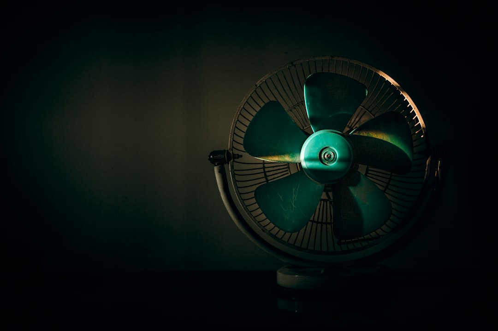

Your furnace blower motor is the workhorse of your heating system. It spins the fan that pulls air across the heat exchanger and pushes warm air through your ducts, running for long stretches during the heating season. When it fails or starts making noise, the furnace may still produce heat, but that heat never reaches the rooms where you need it.

A failing blower motor is one of the more common furnace problems, and it can often be diagnosed without a service call. But mistaking a dirty filter, a weak capacitor, or a control problem for motor failure can waste money on an unnecessary replacement. Replacing the motor incorrectly, with the wrong part, careless wiring, or the root cause left in place, leads to early failure of the new unit.

Low airflow is also a safety issue, not just a comfort issue. A furnace that runs without enough air moving across the heat exchanger can overheat, and its safety controls may shut it down or cycle it repeatedly. This guide covers how to recognize a failing blower motor, how to rule out look-alike problems, what a replacement involves, which mistakes to avoid, and when to hand the job to a professional.

Photo by <a href="https://unsplash.com/@rajat_sarki?utm_source=artlines_blog&utm_medium=referral">rajat sarki</a> on <a href="https://unsplash.com/?utm_source=artlines_blog&utm_medium=referral">Unsplash</a>

## Why Furnace Blower Motors Fail

Blower motors often run for many years, but lifespan varies widely with the motor type, how hard the furnace works, and the conditions around it. Knowing the common failure mechanisms helps you tell genuine wear from a problem that is cheaper to fix.

**Dust and bearing wear**

Dust and lint collect in the blower compartment even with a filter in place. They settle on the motor and the blower wheel, which restricts airflow and can make the motor work harder. A layer of dust on the motor body also traps heat, which is hard on the windings and their insulation. Dust that works into the bearings increases friction. Many motors rely on bearings with limited lubrication, and once that lubrication breaks down, friction, heat, and noise build. Bearing wear tends to get worse over time rather than level off.

**Electrical stress and the capacitor**

Many traditional furnace blowers use a permanent split capacitor (PSC) motor, which depends on a run capacitor to start and run properly. Capacitors weaken with age and heat. A weak capacitor can make a motor hum, start slowly, run hot, or fail to start at all, and sustained strain can damage the motor itself. That is why the capacitor is worth checking before you condemn the motor. Note that newer electronically commutated motors (ECM) work differently and do not use a run capacitor in the same way, so the advice about capacitors applies to PSC systems.

**Moisture, corrosion, and the environment**

A furnace in a damp basement, or one exposed to corrosive vapors, faces added stress. Humidity promotes corrosion on electrical contacts and connectors. Dust-heavy spaces, such as unfinished areas with construction debris, pet hair, or a leaky return duct pulling in dirty air, shorten motor life. A clean, dry furnace area and a regularly changed filter are the simplest ways to protect the motor.

**Restricted airflow**

A clogged filter, closed or blocked registers, or dirty ductwork increase the resistance the blower works against. Persistent restriction stresses the motor and can cause overheating of the furnace itself. If you replace a motor without correcting the restriction, the new motor faces the same conditions that wore out the old one.

## Signs Your Furnace Blower Motor Is Failing

A failing blower motor usually gives warning before it stops. Recognizing the symptoms lets you act before you lose heat.

**Audible noise**

A healthy blower runs with a steady, even sound. These noises suggest a problem:

- **Squealing or chirping:** Often bearing friction, or sometimes a belt on older belt-drive blowers. It may be loudest at startup and worsen over weeks.
- **Grinding or scraping:** Debris in the blower housing, a wheel contacting the housing, or badly worn bearings. Shut the furnace off and do not keep running it.
- **Rattling or buzzing:** A loose panel, a loose mounting, or a blower wheel that is loose on its shaft. A loose wheel can get worse quickly.
- **Humming without turning:** Often a weak or failed capacitor on a PSC system, a seized bearing, or a stuck wheel. Do not leave a humming motor energized for long, since it can overheat.
- **High-pitched whining:** The motor working against resistance, such as worn bearings or a wheel that drags.

**Weak or no airflow**

Hold your hand over a supply register while the blower runs. You should feel a consistent flow of air. A gradual decline across a season or more can point to a dirty filter, dirty wheel, duct problems, or a tired motor. Sudden loss of airflow with the motor still audibly running can mean the blower wheel has come loose from the shaft.

**Running constantly or cycling erratically**

Some behaviors originate in the thermostat, the control board, or the furnace's safety switches rather than the motor. If the blower runs nonstop, shuts off early, or the furnace repeatedly starts and stops, the cause could be a motor issue, an overheating condition tripping a limit switch, or a control fault. Do not assume the motor is at fault.

**Burning smell**

A burning or electrical smell can come from an overheating motor, failing wiring, or a component about to fail. Shut off the furnace at the thermostat and at the breaker, and call a professional. A brief dusty smell on the first startup of the season is common as accumulated dust burns off, but a persistent or sharp burning odor is not.

**Gas smell or carbon monoxide alarm**

If you smell gas, or a carbon monoxide alarm sounds, leave the home and call your gas utility or emergency services from outside. Do not try to diagnose the furnace. For more on this topic, see our guide on [carbon monoxide and furnace safety](/2026/11/07/carbon-monoxide-and-furnace-safety-what-homeowners-need-to-know/).

## Diagnosing a Failing Furnace Blower Motor

Before buying a replacement, confirm the motor is actually the problem. Several issues mimic motor failure and have different fixes.

**Start with the simple, safe checks**

Check the air filter first. A badly clogged filter can make airflow feel like a failed motor. Replace it and see whether airflow improves. Also confirm that supply registers and return grilles are open and unblocked, and that the thermostat is set to call for heat and has working batteries if it uses them.

Then check the furnace's own signals. Many furnaces have a status light visible through a small window, with blink codes explained on a label inside the door or in the manual. A code can point directly at a pressure switch, limit switch, or blower fault. Look it up in your manual rather than guessing.

**Inspect the blower compartment with the power off**

Before opening the blower compartment, turn the furnace off at the switch and at the breaker. Furnaces commonly have a door switch that cuts power when the panel is removed, but do not rely on it as your only protection. With power off, look for heavy dust on the wheel, a wheel that wobbles or has slipped on the shaft, debris in the housing, and any burn marks or melted insulation on wiring. Turn the wheel by hand. It should spin freely and quietly. Grinding, rubbing, or stiffness suggests worn bearings, a bent shaft, or a wheel contacting the housing. A wheel that rubs the housing can also be a mounting or wheel problem, not necessarily the motor.

**Be cautious with live electrical testing**

Measuring voltage at motor terminals while the furnace runs means working near exposed live conductors. This is where many injuries happen. If you are not trained and equipped to do it safely, skip it and have a technician perform live testing. A technician can determine whether the control board is sending power to the motor, which separates a control fault from a motor fault. In general, a motor that receives the correct supply and control signal but will not run points to the motor or capacitor, while no signal points upstream.

**Evaluate the capacitor on a PSC system**

The run capacitor is a metal can, often cylindrical or oval, mounted near the motor. A bulged top, leaking fluid, or cracked case is a clear sign of failure, but a capacitor can fail without any visible sign. Capacitors can hold a dangerous charge even when the power is off. Do not touch the terminals, and do not short them with a screwdriver. Have a technician test and discharge it properly. If a capacitor is replaced, the replacement must match the original's microfarad (µF) rating and voltage rating as printed on the label.

**Listen to startup behavior**

A healthy motor starts promptly and settles into a steady sound. Hesitation, humming before it starts, or noise only in the first few seconds can point to the capacitor or startup problems. Noise that continues throughout the cycle more often points to bearings, the wheel, or mounting. These patterns are clues, not a diagnosis, and an inspection should confirm them.

## How to Replace Your Furnace Blower Motor

Replacement is a significant repair that involves electrical connections, careful handling of the blower wheel, and matching the correct part to your furnace. If you are not comfortable with any of it, hire a professional. Check your furnace manual and any warranty terms before you begin.

**Safety warning:** Turn off power at the furnace switch and at the circuit breaker, and verify that power is off with a properly rated voltage tester before touching any wiring. Never rely on a switch or breaker label alone. If your furnace uses gas, do not disturb gas piping or burner components during this work. A capacitor can retain a charge after power is removed, so do not touch its terminals. For general guidance, see [OSHA's electrical safety resources](https://www.osha.gov/electrical). If you are uncertain at any point, stop and hire a professional.

**Step-by-step replacement**

1. **Identify the exact replacement part first.** Find the motor's nameplate and record the manufacturer, model number, voltage, horsepower, RPM, rotation direction, frame or mounting style, and whether it is a PSC or ECM motor. Photograph the nameplate and the furnace's model and serial plate. A parts supplier or the furnace manufacturer can confirm the correct match, and a mismatch is a common cause of repeat failure.

2. **Turn off power and verify it is off.** Shut off the furnace switch and the breaker, then test for voltage at the motor connections with a properly rated tester. If you cannot confirm that the power is off, stop.

3. **Photograph and label the wiring.** Take clear photos from several angles before disconnecting anything. Label each wire or connector so it can be reconnected exactly as it was. Many motors connect through a plug, and some have separate leads for speed taps and the capacitor.

4. **Disconnect and remove the motor assembly.** Depending on the furnace, the blower assembly may slide out as a unit, with the motor mounted to the wheel housing. Note how the assembly is secured and how the motor is mounted so you can restore it exactly. Support the weight so nothing drops onto the wheel or wiring.

5. **Move the wheel and mounting hardware as needed.** Some replacement motors require moving the blower wheel from the old shaft. Mark the wheel's position on the shaft before loosening the set screw so you can restore the same placement. Clean the shaft, make sure the set screw seats against the flat of the shaft if there is one, and tighten it firmly. Spin the wheel by hand to confirm that it is centered and does not rub.

6. **Install the new motor and reconnect the wiring.** Reinstall mounting hardware by hand first to avoid cross-threading, then snug it without overtightening. Reconnect each wire or plug according to your photos and labels. Install a replacement capacitor if the new motor or manufacturer instructions call for one, matching the specifications exactly. Make sure no bare conductor is exposed and no wire contacts the spinning wheel.

7. **Reassemble, restore power, and test.** Put all panels back. Restore the breaker, then call for heat. Watch and listen through at least a full heating cycle. The motor should start smoothly, run quietly, and produce steady airflow. If it hums, smells hot, makes noise, or fails to start, turn the power off and recheck your work or call a professional.

**Why specifications matter**

Voltage, horsepower, RPM, rotation direction, and motor type all have to suit the furnace. A motor that is the wrong match can run hot, move too little or too much air, or fail early. PSC and ECM motors are not simple substitutes, since an ECM is paired with an electronic control module and the furnace control system. Confirm any substitution with the furnace manufacturer or a qualified technician instead of assuming a motor is a direct replacement.

## Common Mistakes When Replacing a Furnace Blower Motor

Small errors cause poor performance or early failure of the replacement. These are the ones to avoid.

**Skipping proper power verification**

The most dangerous mistake is working on a live circuit. Turn off the furnace switch and the breaker, then verify the absence of voltage with a suitable tester. Contact with live household voltage can cause serious injury or death. Do not trust a switch position or a breaker label by itself.

**Touching the capacitor**

A capacitor can hold a charge after power is off. Do not touch its terminals or bridge them with tools. If you are not trained to discharge it safely, leave capacitor handling to a technician.

**Ordering the wrong motor**

Match the nameplate information, not just the physical look of the motor. Wrong voltage, horsepower, speed, rotation, mounting, or motor type can cause overheating, poor airflow, or failure to run. Photograph the original nameplate and confirm the part before ordering.

**Replacing the motor when the problem is elsewhere**

A weak capacitor, a failed control board, a tripped limit switch from a blocked filter, or a wiring fault can look like a dead motor. Confirm the cause first. Replacing a good motor wastes money and leaves the real fault in place.

**Ignoring the capacitor on a PSC system**

If you install a new PSC motor and leave a weak capacitor in place, the new motor can be stressed from the start. Have the existing capacitor tested, and replace it with an exact match when appropriate.

**Cross-threading or overtightening hardware**

Start each fastener by hand. If one binds, back it out and check the alignment. Overtightening can strip threads, crack housings, or distort the mounting and cause vibration and noise.

**Mixing up connections**

Wiring errors can cause a motor to fail to run, run at the wrong speed, run in the wrong direction, or overheat. Use your photos and labels, and consult the new motor's wiring diagram. If the diagram differs from the old motor's wiring, do not guess. Get professional help.

**Leaving the blower compartment dirty**

Dust contributed to the old motor's trouble. Before installing the new one, clean the blower compartment and wheel with a vacuum and a soft brush, working carefully around wiring. Do not attempt to clean or modify the heat exchanger or burner area yourself. Those components are safety-critical and are for a qualified technician.

**Ignoring the root cause**

If the old motor died because of a clogged filter, leaky ducts, poor return airflow, or moisture, fix that problem too. Otherwise the replacement is likely to suffer the same fate.

## When to Call a Professional

Call a licensed HVAC technician if you are not comfortable working with electrical components, if the furnace is still under warranty, or if the work might affect warranty coverage. Check your warranty terms before starting any repair yourself.

Call a professional right away for a burning smell, visible scorching or melted wiring, repeated tripping of the breaker, a seized or locked motor, or a motor that hums without turning. Also hire a technician if the cause is unclear, if you suspect a control board or limit switch problem, if the blower is part of an ECM system that needs matched components, or if you need live voltage testing.

Treat any gas smell or carbon monoxide alarm as an emergency. Leave the home and call your gas utility or emergency services from a safe location.

Repair costs vary by region, furnace type, parts availability, and whether the work happens during normal hours or as an emergency call. Ask for a written estimate that separates parts and labor, and ask the technician to explain the diagnosis, including how they confirmed the motor was the cause.

## FAQ

**How much does a furnace blower motor replacement cost?**

Costs vary widely, so no single figure applies to every home. The price depends on the motor type, since ECM motors generally cost more than PSC motors, as well as the furnace model, your region, labor rates, whether a capacitor or other parts also need replacement, and whether the call is an emergency. Ask local HVAC contractors for written estimates that itemize parts, labor, and diagnosis. If you are weighing a repair against replacing an older furnace, ask the contractor to explain the furnace's overall condition, not just the motor.

**Can I replace the blower motor myself?**

Some homeowners with solid electrical skills do, but it is not a beginner project. You need to verify that power is off, label and restore wiring correctly, match the exact motor specifications, handle the blower wheel carefully, and deal safely with the capacitor. The time required depends on how the blower assembly is built and how easily it comes out. If any step feels uncertain, especially the electrical connections, call a professional. Also check your warranty and your furnace manual first.

**How long does a furnace blower motor last?**

There is no guaranteed lifespan. Motors often last many years, but life depends on motor type, run time, dust, moisture, filter habits, airflow restrictions, and the quality of the installation. A clean, dry furnace area with regular filter changes helps. A dusty or damp environment, or a duct system that restricts airflow, can shorten motor life. Annual professional maintenance gives a technician the chance to spot noise, wear, a weak capacitor, or overheating signs before a failure leaves you without heat.

**What's the difference between ECM and PSC motors?**

A PSC (permanent split capacitor) motor is the traditional design. It typically uses a run capacitor and is commonly set to run at one of a few fixed speed settings. An ECM (electronically commutated motor) uses electronic controls to adjust its speed and can be more efficient, which is one reason many modern furnaces use them. [ENERGY STAR](https://www.energystar.gov/products/heating-cooling/furnaces) provides general information about efficient furnaces. ECM motors and their control modules generally cost more than PSC motors. They are also not interchangeable with PSC motors without checking compatibility, since the furnace controls must work with the motor. Ask the furnace manufacturer or a qualified technician before changing motor types.

## Conclusion

A failing blower motor is common and often shows warning signs: squealing, grinding, humming, weak airflow, or erratic cycling. Before replacing the motor, rule out the simpler causes, such as a clogged filter, a dirty wheel, blocked registers, a weak capacitor on a PSC system, or a control or limit-switch problem. These can mimic motor failure and are often cheaper to fix.

If you do decide to replace the motor, treat it as serious electrical work. Verify the power is off, never touch the capacitor, photograph and label every wire, and match the motor's specifications exactly, using the nameplate and manufacturer guidance. Clean the blower compartment and correct whatever shortened the old motor's life. If you are uncertain about any part of the job, your furnace is under warranty, or you notice burning smells, scorched wiring, a seized motor, or any sign of gas or carbon monoxide, stop and call a professional.

Prevention is the simplest approach. Replace or clean the filter on the schedule your furnace manual recommends, keep the area around the furnace clean and dry, keep registers and returns unblocked, and schedule regular professional maintenance, especially as the furnace ages.

**Help other homeowners stay warm - share this guide with anyone struggling with furnace noise.**

**Related reading:**
- [Best Hvac Maintenance Tools Every Homeowner Should Own](/2026/06/30/best-hvac-maintenance-tools-every-homeowner-should-own/)
- [Carbon Monoxide And Furnace Safety What Homeowners Need To Know](/2026/11/07/carbon-monoxide-and-furnace-safety-what-homeowners-need-to-know/)

  
<strong>About the Author</strong>

  
The HVAC Owners Manual team researches heating and cooling systems to help homeowners understand what's normal, what's not, and when to call a pro. Our guides are built from manufacturer documentation, industry standards, and contractor-community knowledge.

